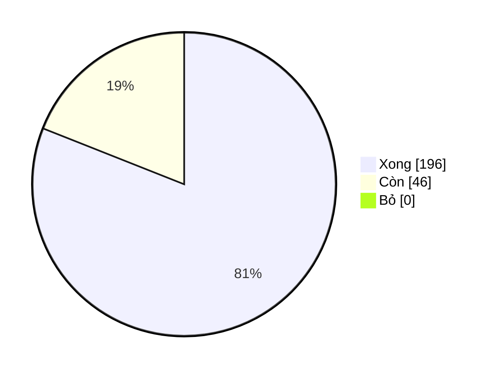

# claude-plugins

Cập nhật 2026-11-11 · commit `f73fd04`

## Tóm tắt

- **Tổng tiến độ:** 81% (196/242 task xong, 0 bỏ).
- **Plan:** 9 đang mở, 3 xong / 12 plan.
- **Đang chạy:** Plan: đồng bộ tài sản tài khoản (70%), Plan: hh-store (giai đoạn 1 + 2) (67%), Plan: hand-ext lưu brief/prompt/meta/timestamp và lệnh đo test code (hybrid-hands 0.22.0) (67%).
- **Việc kế tiếp:** P1.2 — overlay Codex và ranh giới: file dự kiến account_sync_manifest.py, account_sync_as… — _Plan: đồng bộ tài sản tài kho…_.
- **Hoạt động 14 ngày:** 258 commit.

## Ghi chú (giữ tay)

<!-- plan-status:manual:start -->
_Ghi chú, rủi ro, quyết định cần người (giữ nguyên khi chạy lại)._
<!-- plan-status:manual:end -->

## Các plan

| Plan | Trạng thái | Tiến độ | Còn |
|---|---|---|---|
| [Plan: đồng bộ tài sản tài khoản](../work-in-progress/dong-bo-tai-khoan/plan.md) | 🔄 Đang làm | ▓▓▓▓▓▓▓░░░ 70% | 3 |
| [Plan: hh-store (giai đoạn 1 + 2)](../work-in-progress/hh-store/plan.md) | 🔄 Đang làm | ▓▓▓▓▓▓▓░░░ 67% | 7 |
| [Plan: hand-ext lưu brief/prompt/meta/ti…](../../hybrid-hands/docs/2026-11-06-hand-ext-run-audit-plan.md) | 🔄 Đang làm | ▓▓▓▓▓▓▓░░░ 67% | 3 |
| [Plan: dòng Claude tuần trên cây Paseo c…](../../hybrid-hands/docs/2026-11-06-paseo-claude-week-live-plan.md) | 🔄 Đang làm | ▓▓▓▓▓▓▓▓▓░ 89% | 1 |
| [Plan: mô hình 3 tầng Opus / Sol / dsh](../../hybrid-hands/docs/2026-11-07-ba-tang-opus-sol-dsh-plan.md) | 🔄 Đang làm | ▓▓▓▓▓▓▓▓▓▓ 97% | 1 |
| [Plan: cấu hình global và key riêng cho…](../../hybrid-hands/docs/2026-11-09-cau-hinh-global-plan.md) | 🔄 Đang làm | ▓▓▓▓▓▓░░░░ 57% | 13 |
| [Hand/subagent thành agent Paseo — plan…](../../hybrid-hands/docs/2026-11-09-hand-paseo-agent-plan.md) | 🔄 Đang làm | ▓▓▓▓▓▓▓▓▓░ 90% | 4 |
| [Plan: luồng mặc định Opus → Sol → dsh](../../hybrid-hands/docs/2026-11-09-luong-mac-dinh-dsh-plan.md) | 🔄 Đang làm | ▓▓▓▓▓▓▓▓▓░ 91% | 2 |
| [Plan: nâng cấp điều phối và switch hybr…](../work-in-progress/nang-cap-dieu-phoi/plan.md) | ⏳ Chưa bắt đầu | ░░░░░░░░░░ 0% | 12 |
| [Xây plugin dev-workflow và skill nghiệp…](../../dev-workflow/docs/plans/2026-10-09-build-dev-workflow.md) | ✅ Xong | ▓▓▓▓▓▓▓▓▓▓ 100% | 0 |
| [Plan: dọn worktree và chặn đầy ổ](../work-in-progress/don-worktree/plan.md) | ✅ Xong | ▓▓▓▓▓▓▓▓▓▓ 100% | 0 |
| [side-session v2: một cách mở phiên phụ,…](../../hybrid-hands/docs/2026-11-05-side-session-v2.md) | ✅ Xong | ▓▓▓▓▓▓▓▓▓▓ 100% | 0 |

## Phân bố task

## Việc đang mở (tối đa 10)

- [ ] P1.2 — overlay Codex và ranh giới: file dự kiến account_sync_manifest.py, account_sync_as… — [Plan: đồng bộ tài sản tài kho…](../work-in-progress/dong-bo-tai-khoan/plan.md)
- [ ] P3.2 — MCP và phương án theo phiên: file dự kiến account_sync_official.py, accounts_cmd.p… — [Plan: đồng bộ tài sản tài kho…](../work-in-progress/dong-bo-tai-khoan/plan.md)
- [ ] P4.2 — review, version và cập nhật cài đặt: file dự kiến .claude-plugin/plugin.json, CHAN… — [Plan: đồng bộ tài sản tài kho…](../work-in-progress/dong-bo-tai-khoan/plan.md)
- [ ] Xác minh tên trường stdin hook (transcript_path, agent_transcript_path) bằng payload thật… — [Plan: hh-store (giai đoạn 1 +…](../work-in-progress/hh-store/plan.md)
- [ ] Lần chạy lạnh hh-ps ~4,1 s (calibration TTL 300 s + claude auth status) chưa xử lý. — [Plan: hh-store (giai đoạn 1 +…](../work-in-progress/hh-store/plan.md)
- [ ] Pane cần mở phiên Claude mới để nạp watchPaths; chưa xác nhận watchPaths với đường tuyệt… — [Plan: hh-store (giai đoạn 1 +…](../work-in-progress/hh-store/plan.md)
- [ ] Mỗi Stop hook sinh một process python nền ~100 ms, có thể chồng nhau khi dồn dập. — [Plan: hh-store (giai đoạn 1 +…](../work-in-progress/hh-store/plan.md)
- [ ] Chưa có test Linux không kqueue (đường poll stat 2 s). — [Plan: hh-store (giai đoạn 1 +…](../work-in-progress/hh-store/plan.md)
- [ ] hh-ps chỉ tự khởi indexer khi chạy từ tty (lệch có chủ ý: pane/Paseo/hook tự touch) — ghi… — [Plan: hh-store (giai đoạn 1 +…](../work-in-progress/hh-store/plan.md)
- [ ] _last_digest không xoá trong runtime._reset_for_tests (vô hại hiện tại). — [Plan: hh-store (giai đoạn 1 +…](../work-in-progress/hh-store/plan.md)

## Hoạt động 14 ngày qua

258 commit.

- 2026-11-11 f73fd04 Merge fix/plan-status-init-globs (dev-workflow 0.10.1)
- 2026-11-11 2d7e450 fix(dev-workflow): plan-status init collapses sibling plan dirs into <parent>/*/*.md, skips skills/templates/references (0.10.1)
- 2026-11-11 a81da44 Merge feat/plan-status-action: shared Action + plan-status init (dev-workflow 0.10.0)
- 2026-11-11 c6bd6b5 feat(dev-workflow): shared plan-status composite Action + dw plan-status init scaffold (0.10.0)
- 2026-11-11 7a155ba Merge feat/plan-status-ref: plan-status per-page git ref (dev-workflow 0.9.0)
