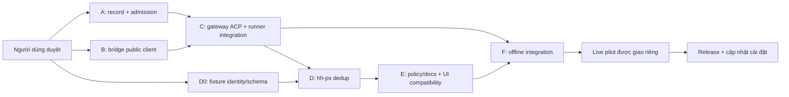

# Hand/subagent thành agent Paseo — plan nháp L2

## Tóm tắt

Plan thực thi [spec ngày 09/11/2026](2026-11-09-hand-paseo-agent-spec.md), **chờ người dùng duyệt**. Khuyến nghị gateway ACP bọc runner hand-ext; public client tạo child trong workspace riêng để giữ cwd. Đây là triển khai mới, không phải đổi tên hand trên UI. Gate chính: chốt sidebar/track, gateway/direct, thay đường native mới, archive/reopen/retention. Chưa được phép mutation Paseo thật hoặc sửa config trong lượt nghiên cứu này.

Order repo đã được người dùng cập nhật qua Opus: **codex gpt-6.1-sol low → dsh → claude-v1 → claude-v2**, bằng chứng commit `6d3e9c7`. Defaults plugin chưa đổi; không chép order cũ vào implementation hay sửa config worktree để đồng bộ. Plan chia theo owner file; cùng file/phụ thuộc chạy tuần tự. Sol tự thiết kế/review, giao L0/L1 cho hand theo policy/account hiện hành; khi pick hiệu lực chọn codex cùng account thì native Sol low, fork_turns=none, brief tự chứa, luật dữ liệu nguyên văn. Không giao hand review hand khác.

Mức test **tối thiểu**, mỗi gói 1 đường chính và tối đa 2 lỗi/biên có ý nghĩa, fixture giả, không gọi API model. Full suite chỉ **một lần cuối** sau tích hợp. Live smoke là gate riêng cần brief cho phép tạo/điều khiển child/workspace và trần chi phí; task tài liệu này không cho phép. Không tự thêm analytics, A/B, SAST/DAST vì không thuộc hai nhóm mức kỹ trong AGENTS.md.

## 1. Gate trước code và thứ tự gói

- [ ] **G0 — Opus/người dùng:** ghi quyết định cho bảy câu hỏi mở của spec vào spec. Nếu sidebar lồng bắt buộc, thêm owner upstream app; không hứa plugin hh-tree sửa native list.
- [ ] **G0 — Sol:** đọc lại AGENTS.md/CLAUDE.md phạm vi áp dụng, xác minh base main mới và thay đổi của sol-ws-hoi; giữ file chưa commit của người khác. Chốt API contract giữa các gói trước khi giao hand; không sửa `lib/side_session/*` trong nhánh tính năng này.
- [ ] **G0 — Sol:** mỗi brief hand ghi PHẠM VI GHI, acceptance criteria, tối đa 3 ca test và luật dữ liệu nguyên văn (mục 7). Tổng native + hand-ext trong scope không quá `ext_hand.max_parallel`; không đổi config/slots. Không phát writer trùng khi trạng thái spawn chưa rõ.
- [ ] **G0 — phiên nghiên cứu hiện tại:** chỉ hai docs + bàn giao, kiểm link/diff, commit nhánh phiên. Không plugin test/bump/install; chưa đánh dấu checkbox implementation xong.



A và B độc lập file sau khi chốt contract. D0 chỉ fixture/contract của D, không sửa runtime D trước khi C ổn định. C sở hữu điểm tích hợp runner/run_cmd/registry; A không sửa chúng. D và E không cùng sửa models/tree. Không ép đủ 4 hand nếu phụ thuộc chưa sẵn sàng.

## 2. Gói A — record điều khiển và shared pool

**Owner file đề xuất:** mới `plugins/hybrid-hands/lib/hand_ext/execution_state.py`, `execution_admission.py`, `execution_supervisor.py`; sửa `parallel.py` chỉ trong gói này. Test mới `tests/test_hand_paseo_admission.py`. Các đường dẫn trong plan tính từ `hybrid-hands/`; tên file mới là dự kiến, không phải link tới file đang tồn tại.

- [ ] Định nghĩa record versioned của spec mục 4, keys invocation/attempt/epoch, parent canonical, exact target/agent/workspace, nullable exit và provenance usage. Control record tách best-effort registry; lỗi ghi intent/admission phải chặn trước writer.
- [ ] Implement atomic state/lease và shared supervisor giữ lock xuyên executor/finalization; reconcile process identity, không nhả vì frontend chết, không unlink lock hoặc TTL expiry suy writer chết.
- [ ] Admission tính shell + managed + native legacy active/unresolved trong cùng scope; preserve max_parallel 1..4/exit 8. Ghi rõ native ngoài dispatcher chỉ quan sát được, không cưỡng chế; gate release bắt mọi task mới đi dispatcher.
- [ ] Khóa concurrent prompt, immutable backend/account/cwd; lưu phạm vi ghi và chặn công việc cùng file/phụ thuộc đã khai báo. Chỉ accept epoch/receipt một lần; record hỏng hoặc owner unknown không chạy lại. Không thêm secret vào labels/state diagnostic.
- [ ] Giao interface cho C: acquire/settle/reconcile, status/exit mapping; A không tự gọi backend/Paseo.

Acceptance: một slot cho một executor, unresolved vẫn chiếm chỗ, retry backend trong invocation không giữ hai slot. Test hẹp (tối đa 3 nhóm): (1) shell + managed + native fake đếm đúng scope, (2) frontend crash khi worker fake còn sống không mở slot, (3) cùng epoch nhận hai request chỉ một owner.

Lệnh dự kiến sau khi có file: `python3 -m unittest discover -s tests -p 'test_hand_paseo_admission.py'`; chạy thêm regression hẹp `python3 -m unittest discover -s tests -p 'test_hand_ext_parallel.py'` nếu đổi parallel. Cwd mọi lệnh Python trong plan: `hybrid-hands/`.

## 3. Gói B — public client bridge Paseo riêng

**Owner:** mới `plugins/hybrid-hands/lib/hand_ext/paseo_transport.py`, `paseo_bridge.mjs`, test `tests/test_hand_paseo_transport.py`, fixture mock client trong `tests/fixtures/hand_paseo/`. **Không** sửa bridge/state/actions của side-session; chỉ đọc mẫu.

- [ ] Dùng client/discovery chính thức đã cài, pinned target identity; không đọc/in auth/config credential, không gọi RPC tự chế hoặc sửa daemon storage. Capability detection theo version/method và provider catalog, không chỉ `command -v paseo`.
- [ ] Tạo workspace local tại isolated cwd có sẵn của hand-ext, gắn existing project ID được xác minh; không tự tạo project khi mapping chưa rõ. Create child bằng explicit workspace/caller, UUID/key lưu trước request. Không background/internal/autoArchive làm mất UI.
- [ ] Create không prompt, fetch kiểm exact cwd/parent/workspace/provider trước dispatch; send dùng receipt/epoch đã cấp. Expose status/wait/cancel/archive/history/recovery riêng, chỉ exact child ID, reject target changed. Không có lệnh all hoặc mutation lên parent.
- [ ] Fallback shell chỉ khi chứng minh chưa dispatch; ambiguous create/send đưa unresolved để reconcile. Limit số trang/thời gian đọc, không loop vô hạn. Đảm bảo transport exit không dùng nhầm 7/8 của policy.
- [ ] Source spike read-only lại public create cwd, client idempotency và reopen đúng identity trên version triển khai. Nếu open/history public API không bảo toàn ID hoặc phát prompt thì dừng phần dependent, ghi gate thay vì tự resume bằng agent mới.

Acceptance: public shape giữ cwd riêng + parent; create timeout không spawn shell trùng; cancel/archive không thể target parent. Test hẹp: (1) fake registry/client own workspace path, (2) create/send ACK lost rồi reconcile cùng UUID/receipt, (3) wrong target/parent reject trước mutation. Lệnh dự kiến `python3 -m unittest discover -s tests -p 'test_hand_paseo_transport.py'` (test gọi Node fake client khi cần, không daemon).

## 4. Gói C — gateway ACP, runner và frontend dispatcher

**Owner:** mới `plugins/hybrid-hands/bin/hand-paseo-acp`, `lib/hand_ext/paseo_gateway.py` hoặc `.mjs` theo thư viện ACP đã chọn, `execution_worker.py`; sửa `run_cmd.py`, `runner.py`, `run_registry.py`, `cli.py`, `config.py`, `report.py`. Nếu cần parser/ledger changes, gói C sở hữu, không giao writer khác vào `backends/*`/`ledger.py` đồng thời. Test `tests/test_hand_paseo_gateway.py`, `test_hand_paseo_execution.py`, fixtures executor giả.

Chia tiếp trước khi giao hand để mỗi gói cỡ L1: **C1 protocol** sở hữu executable/gateway + gateway test; **C2 executor** sở hữu worker/runner/registry/report + execution test; **C3 tích hợp** sở hữu run_cmd/cli/config sau C1+C2. C1 và C2 có thể chạy song song sau contract A/B, fixture của mỗi gói nằm file riêng. C3 tuần tự, không writer thứ hai chạm runner/run_cmd. Sol chốt language/dependency ở spike trước khi hai hand viết.

- [ ] Spike thư viện ACP server phù hợp, license/dependency đóng gói; không mặc định lấy dependency từ node_modules addon có trên máy khác. Chọn Python/Node theo runtime phân phối thật, không tải package trong nhiệm vụ này. Khóa contract protocol trước code.
- [ ] Tách frontend orchestration và worker, giữ run command shell backward compatible. Gateway là controller tin cậy, gọi worker nội bộ; worker không gọi `hand-ext run`/Paseo/subagent. Chỉ một component giữ admission/finalize/ledger, không reserve slot hai lần.
- [ ] Implement ACP initialize/new/prompt/cancel/resume-or-load/close với stdio sạch. Session mới/resume/history không spawn model; mọi prompt kiểm record + A, catalog/options fixed backend/model/effort/account; malformed/duplicate/concurrent request không chạy thêm executor.
- [ ] Chạy CLI backend hiện có trong worktree đã chuẩn bị, giữ dirty baseline, env scrub, correct account home, sandbox/read-only/browser/max-turns/timeout/token cap. DSH giữ launch trống tránh .env và Go route; không thay bằng profile ACP shipped deepseek-official.
- [ ] Stop/EOF/SIGTERM/crash drain/cancel/reap process group đúng owner; quiescent rồi snapshot patch/report/usage, finalize một lần. Nếu không chứng minh hết writer thì unresolved, cấm patch apply/fallback/nhả slot. Không chỉ kill frontend.
- [ ] Giữ retry/quota/day guard/capacity policy hiện hành theo effective repo order. Exit 7/8 và OS exit backend tách outcome gateway/transport. Record missing usage giữ unknown, không lấy 0 mặc định làm mẫu thật; preserve cache token categories.
- [ ] Emit assistant/tool/final projection và token usage từ parser vào Paseo, không mirror raw credential/stderr; ledger/report vẫn canonical. Report có agent/workspace/transport IDs và limitations; wait idle chưa đủ để trả thành công nếu outcome chưa durable.
- [ ] Epoch gửi tiếp trong cùng history có task brief mới tự chứa, backend cố định; baseline/patch delta mới, không áp patch cũ lần hai. Full native conversation resume chưa trong MVP. Fallback backend là attempt/agent riêng sau prior settlement, không đổi account âm thầm.
- [ ] Config/schema vận chuyển shell/auto/required, default shell; không sửa config repo người dùng. Gateway provider registration/setup bằng official host settings/tool, không hand edit credential/settings/installation ledger. Native-intent dispatcher chỉ bật khi G0 duyệt thay Ngoại lệ A.

Acceptance: actual fake CLI runner vẫn tạo đúng patch/report/ledger và OS exit; API UI follow-up không vượt admission; cancel đúng child dừng writer. Mỗi file test tối đa 3 nhóm: gateway (1) handshake + prompt + durable outcome, (2) cancel/EOF khi fake writer còn hoạt động, (3) resume/history + duplicate prompt không gọi CLI hai lần; execution (1) dirty baseline + report/ledger exactly once, (2) quota/full/day guard chặn trước backend, (3) daemon ACK mất → không fallback trùng.

Lệnh dự kiến:

```sh
python3 -m unittest discover -s tests -p 'test_hand_paseo_gateway.py'
python3 -m unittest discover -s tests -p 'test_hand_paseo_execution.py'
```

Regression chọn đúng phần thực đổi: `test_hand_ext_isolation.py`, `test_hand_ext_report.py`, `test_hand_ext_registry.py`, `test_hand_ext_capacity.py`; dùng `python3 -m unittest discover -s tests -p '<tên-file>'`, không chạy toàn bộ hand-ext ở mỗi vòng. Không thêm test docs hay test lại ACP SDK.

## 5. Gói D — identity, usage và chống đếm trùng

**Owner:** `lib/hh_ps/models.py`, `registry_source.py`, `native_source.py`, `tree.py`, `usage_enrichment.py`; chỉ sửa `machine_usage.py` nếu chứng minh cần dedup mới. Test mới `tests/test_hh_ps_paseo_hand.py`. Phụ thuộc schema A và output C; D0 có thể viết fixtures giả trước.

- [ ] Fields mới thêm cuối với defaults; mapping explicit target/agent/epoch → run/attempt/thread/parent canonical. Một logical execution hiện một lần; managed child không thành root/side-session thứ hai, không ăn giới hạn 6 phiên phụ.
- [ ] Không nhận diện Codex exec gateway là native spawn; native legacy vẫn sessions fixed path, không run/meta/report/ledger giả. Nếu một thread thấy qua rollout + managed record thì ưu tiên mapping explicit, thiếu bằng chứng giữ unknown.
- [ ] Usage per execution chọn một provenance, không cộng ACP projection + ledger + rollout; machine GPT vẫn token delta sessions + archived_sessions dedup thread/event, không lấy tổng cây. Claude/Go giữ nguồn account đúng, giá canonical duy nhất, quota GPT không suy từ USD/token.
- [ ] Status/exit failure ưu tiên, nullable unknown; elapsed/ended/counts/pool/colors giữ contract. hh-ps text/JSON vẫn orphan; panel và tree-pane không hiện nhóm orphan.

Acceptance/test hẹp 3 nhóm: (1) cùng fake execution có ba nguồn chỉ một dòng và một phần usage, (2) native legacy + managed new cùng cha/pool, (3) unknown/cancel/archive không biến thành done hoặc usage 0. Lệnh `python3 -m unittest discover -s tests -p 'test_hh_ps_paseo_hand.py'`; regression `test_hh_ps_native.py` và `test_hh_ps_usage.py` chỉ nếu đường native/usage đổi.

## 6. Gói E — policy, UI compatibility và tài liệu vận hành

**Owner:** `plugins/hybrid-hands/skills/ext-hand/SKILL.md`, `skills/paseo/SKILL.md`, `templates/side-session-prompt-codex.md`, `templates/side-session-prompt-claude.md`, `agents/hand.md` nếu tồn tại, `hybrid-hands/README.md`, `paseo-hh-tree/OVERVIEW.md`; tên `skills/templates` ở đây nằm dưới plugin. Không sửa AGENTS.md hoặc config ngoài brief implementation được duyệt. Cập nhật các policy tương ứng chỉ sau G0.

- [ ] Ghi rõ native-intent managed khác native provider legacy, effective repo order mới, pick/guard và giữ account/model/effort; brief tự chứa và data law nguyên văn.
- [ ] Hướng dẫn track/tab vs sidebar native, shell fallback không có Paseo agent, wrong target/unresolved recovery; stop/archive exact child, reopen history không model, gửi tiếp task mới.
- [ ] Hướng dẫn retention và cleanup sau quyết định; local workspace mất cwd không auto recreate. Tham chiếu API recovery đã hợp nhất từ sol-ws-hoi, không sửa file phiên đó.
- [ ] Kiểm panel/Cây phiên/tree-pane chỉ cần schema tương thích từ D. Nếu phải đổi frontend, giao gói E-UI riêng sở hữu `paseo-hh-tree/client/*`, test TS tương ứng; không đụng models/tree Python của D. Giữ native sidebar hierarchy ngoài addon.
- [ ] Statusline dùng shared usage helper, ưu tiên không sửa plugin riêng; nếu cần đổi xin scope implementation riêng với version/changelog riêng. Không claim phase tài liệu đã cập nhật runtime.

Kiểm docs: link nội bộ/file tồn tại, không test text. Nếu đổi UI, cwd `hybrid-hands/paseo-hh-tree/`: `node --experimental-strip-types --test client/*.test.ts` và `npm run typecheck`; dùng dependency có sẵn hoặc setup được duyệt, không tự tải. Acceptance tối thiểu UI: (1) managed child một dòng, (2) native legacy unknown/counts và hidden pool đúng; không snapshot dài.

## 7. Luật dữ liệu chép vào mỗi brief hand

Không in/hiện giá trị `.env`, token, credential ở bất kỳ tầng nào; công cụ của plugin (`hand-ext doctor/run`, đọc hạn mức) được đọc file auth nội bộ, chỉ không được in giá trị. Brief giao hand ngoài chép nguyên văn luật này.
Không đọc `.env` bằng lệnh hay tool hiện giá trị: `cat`, `head`, `tail`, `grep`, `sed`, `awk`, `less`, `more`, `rg`, `Read`, kể cả có che phần sau dấu `=`.
Không đọc hay in token, auth.json, file credential. Không giao hand ngoài việc cần secret hay dữ liệu khách hàng. Chỉ dùng code và fixtures giả công khai được; không đọc transcript/log thật. Không gọi API trả phí, không tạo hay dùng API key.

Hand executor làm trực tiếp phạm vi giao; không hand-ext/side-session/subagent/recursion/giao tiếp phiên khác/review hand khác. Không commit/merge/cập nhật runtime từ hand. Sol review kết quả; lỗi giao lại cùng backend đúng một lần, tiếp tục backend kế tiếp theo order hiệu lực nếu lần hai còn hỏng. Exit 8 chờ slot, unknown reconcile, không duplicate writer.

## 8. Gói F — tích hợp offline, rồi live pilot riêng

- [ ] Sol review từng diff và source citation nhạy về identity/admission, bảo đảm writer ownership và patch/ledger idempotency. Không merge nếu gateway chỉ tạo agent quan sát mà shell chạy độc lập.
- [ ] Chạy 3 luồng fixture tích hợp: (1) create child → prompt → fake CLI → patch/report/usage → history reopen → epoch mới, (2) daemon timeout/frontend crash/ACK mất khi fake writer còn sống → reconcile không duplicate, (3) stop/guard/slot-full → không spawn thêm và không tác động parent. Dùng mock daemon + CLI fixture, không transcript thật.
- [ ] Sau tất cả gói đã review/test hẹp xanh, chạy **full Python suite đúng một lần cuối**, cwd `hybrid-hands/`:

```sh
python3 -m unittest discover -s tests -p 'test_*.py'
```

- [ ] Full TS tests/typecheck chỉ ở addon thực đổi như mục 6; hh-tree-pane nếu thực đổi thì dùng command trong package/README của nó, không tự mở rộng test không liên quan. Nếu full suite lỗi, sửa đúng lỗi rồi chạy lại test hẹp; báo full cuối chưa xanh, không claim full pass từ test hẹp. Chỉ chạy full lần nữa nếu brain cấp brief riêng.
- [ ] **Gate live được giao riêng:** người dùng cho phép disposable repo/workspace/agent trên daemon đúng target, tài khoản subscription sẵn có, trần chi phí/thời gian cụ thể; không tạo key/gọi paid API mới. Chưa có quyền hoặc budget thì dừng live, ghi chưa kiểm; không tự suy từ quyền viết docs.
- [ ] Pilot tối thiểu: (1) một task nhỏ codex đúng model low từ cha thật, (2) stop child đang ghi fixture và xác nhận file ngừng đổi, parent còn hoạt động, (3) archive/open lại cùng ID không model call, gửi tiếp thì admission mới. Xác minh track/tab bằng app; sidebar lồng chỉ nếu G0 yêu cầu và upstream đã hỗ trợ. Claude-v1/v2 và dsh muốn quảng bá supported phải có smoke đúng account/route được giao riêng; chưa smoke thì chưa bật transport đó.
- [ ] Thu metadata/usage tổng hợp và report thật, không log hội thoại/credential; kiểm đúng account/home theo runtime metadata cho phép, không mở auth file. Cancel/reap mọi tiến trình test do phiên tạo; không đụng agent/workspace chính hoặc output/llm. Chỉ cleanup disposable resources được brief cấp.

## 9. Release sau implementation đã duyệt

- [ ] Tích hợp main mới trước release, resolve tuần tự với sol-ws-hoi. Không ghi version cố định từ checkout cũ; chọn minor cho capability mới theo version thực tế, tăng manifest `plugins/hybrid-hands/.claude-plugin/plugin.json` và `CHANGELOG.md` cùng release.
- [ ] Validate JSON/schema/link và chạy `claude plugin validate <repo>/hybrid-hands`. Nếu thêm addon/provider package, validate manifest/requirements/runtime đóng gói của nó. Không bump statusline trừ khi scope riêng thật sự đổi plugin đó.
- [ ] Brain/Sol điều phối commit/push/merge theo chính sách implementation đã được giao; **brief nghiên cứu hiện tại chỉ commit hai docs trên nhánh**, không push/merge/main. Release implementation không phải việc đã làm trong phiên tài liệu.
- [ ] Cập nhật marketplace chính thức: `claude plugin marketplace update hybrid-hands-local`, rồi `claude plugin update hybrid-hands@hybrid-hands-local` theo scope cài thật. Kiểm kê repo **đang dùng** plugin bằng metadata/công cụ chính thức, cập nhật tất cả, không bật ở repo chưa dùng và không hand edit installed_plugins/settings/credential.
- [ ] Provider ACP/setup mới chỉ đăng ký qua host settings/tool chính thức sau duyệt. Nếu đóng gói addon: `paseo plugin install <absolute-path>` và `paseo plugin reload <plugin-id>`; không suy `plugin reload hh-tree` đăng ký provider ngoài addon. Không bật background hay MCP tools toàn cục ngoài scope.
- [ ] Kiểm version **và path được nạp thật** ở repo hiện tại/mọi repo đã cập nhật; kiểm provider command path/capability metadata an toàn trên daemon. Phiên mở không hot load thì báo cần reload/new session. Không claim chỉ nhìn source version là đã cài.
- [ ] Rollout default shell, pilot auto đã duyệt, chỉ mở rộng backend/repo sau parity. Rollback transport về shell bằng cấu hình/setup được duyệt **cho lượt mới**; agent unresolved đang chạy vẫn phải reconcile/stop đúng ID, không tạo shell thay thế.
- [ ] Bàn giao mở đầu tóm tắt ≤15 dòng, mapping backend/provider, bảo đảm còn thiếu, câu hỏi mở, test thật/lệnh thật, commit và runtime chưa kiểm. Tạo `.done` sau khi ghi hoàn tất bàn giao.

## 10. Definition of done theo giai đoạn

**Nghiên cứu hiện tại:** hai file spec/plan có source evidence và khuyến nghị, kiểm link, commit nhánh phiên, bàn giao + `.done`; không đổi plugin hay runtime. **Implementation:** G0 đã chốt, A–F offline xanh và review xong, live pilot được phép đạt đúng scope supported, release/install đã kiểm version/path. Không đánh dấu đạt mục tiêu literal sidebar/native conversion nếu chỉ đạt track hoặc chỉ định tuyến task mới.
