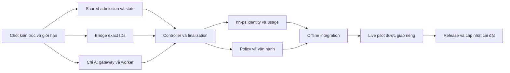

# Hand/subagent thành agent Paseo — plan nháp L2

## Tóm tắt

Plan thực thi [spec ngày 09/11/2026](2026-11-09-hand-paseo-agent-spec.md), **Q1 kiến trúc chưa được người dùng duyệt**. Sau khảo sát plugin: khuyến nghị **B pilot Codex codex-hand low qua adapter dựa bridge side-session**, worktree riêng/caller Sol/.done/rollout; DSH/Claude giữ shell. **A gateway ACP** là lane nếu yêu cầu giữ đủ bảo đảm cả bốn backend và guard mọi prompt UI. **C dùng plugin** chỉ có mẫu tái dùng, chưa có drop-in thay hand-ext; không cài nguyên bộ theo plan mặc định.

**Q2 đã chốt:** mỗi hand workspace riêng trong cùng project + Subagents track/tab cha, không cần sidebar lồng. **Q4 đã chốt:** done vẫn hiện, Sol archive đúng hand sau review; gửi tiếp tự mở lại cùng IDs theo revive 0.33.1. Bridge mẫu chưa truyền caller, finish đang archive ngay .done; revive chỉ mở workspace khi agent đã active. Implementation phải nối đúng các khoảng trống này, không copy nguyên lifecycle side-session.

Order repo người dùng chốt: **codex gpt-6.1-sol low → dsh → claude-v1 → claude-v2** (`6d3e9c7`), không sửa config worktree cũ. Chia gói theo file, việc phụ thuộc tuần tự; Sol thiết kế/review, L0/L1 giao hand theo policy hiện hành. Với cập nhật của người dùng trong phiên này, dùng native Sol low/fork_turns=none, brief tự chứa/luật dữ liệu nguyên văn cho phần L0/L1 được giao; không gọi hand-ext theo config cũ để đảo quyết định order. Không mở thêm side-session, không giao hand review hand khác.

Mức test **tối thiểu**: mỗi gói 1 đường chính, tối đa 2 lỗi/biên quan trọng bằng fixture giả. Full Python suite **một lần cuối**. Nghiên cứu hiện tại không chạy test plugin, không sửa code/config, không tạo agent/workspace/project hay install/reload. Live pilot và release là công việc tương lai chỉ sau duyệt, không tính đã hoàn thành. Ước lượng so sánh trong spec: B 3–5 ngày công, A 8–15, C fork nhỏ 5–10; parity toàn bộ C chưa đủ dữ liệu ước lượng.

## 1. Gate quyết định và chia lane

- [ ] **G0 — người dùng/Opus:** chốt Q1 (A/B/C + chấp nhận bảo đảm giảm của B), Q3 (route native mới), Q5 (context của A nếu chọn A), Q6 retention, Q7 rollout. Không hỏi lại Q2/Q4 đã chốt. Không coi khuyến nghị B là phê duyệt bỏ guard hand-ext.
- [ ] **G0 — Sol:** tích hợp base main mới và contract revive từ sol-ws-hoi; snapshot đã đọc `2eae0b877a226705cd0209cb012861a4fd6d9100`. Không sửa `lib/side_session/*` trong nhánh tính năng hand; nếu API mẫu chưa đủ thì viết adapter riêng, hoặc nêu dependency cho owner sau brief riêng.
- [ ] **G0 — Sol:** chốt schema invocation/attempt/epoch, identity, completion/quiescence và usage provenance trước giao hand. Đọc AGENTS.md/CLAUDE.md phạm vi, giữ thay đổi người khác, brief có phạm vi file và tối đa 3 ca test.
- [ ] **Lane B:** G1+G2 song song → G3 → G4; G5 policy có thể soạn sau schema, hoàn tất sau G3/G4 → G7. Pilot riêng, strict options unsupported phải fallback shell trước dispatch; không thay mặc định hand-ext run.
- [ ] **Lane A:** dùng G1/G2/G4/G5 chung, thêm G6 protocol/worker trước G3 tích hợp gateway. A không lấy direct completion .done làm OS exit; dùng runner thật. Không viết G6 nếu chọn B.
- [ ] **Lane C:** spike riêng trước implementation: chọn đúng một plugin/pin, license/notice, compatibility 0.15.0, delta so với guards/pool/patch. Firstmate gần placement, Playbooks gần workflow, SLP gần evidence; không thêm manager cạnh Sol khi chưa duyệt. Agent-team chưa rõ license không chọn copy/fork. Sau spike phải sửa plan quanh phương án C cụ thể, không triển khai 3 lane cùng lúc.



G1/G2 khác file nên chạy song song sau chốt interface; G3 sở hữu integration, không giao writer khác vào run_cmd/runner. G4/G5 khác file chạy song song khi schema ổn. Fixture riêng mỗi gói. Tổng native + hand-ext ≤ ext_hand.max_parallel (1..4), unknown reconcile/wait, không bật parallel-subagents/đổi slots/config. Không ép đủ concurrency khi dependency chưa sẵn sàng.

## 2. G1 — identity, durable state và shared admission

Owner đề xuất (đường dẫn từ `hybrid-hands/`, tên mới là dự kiến; file liệt kê chỉ basename thuộc cùng thư mục của file đầy đủ đứng trước): mới `plugins/hybrid-hands/lib/hand_ext/execution_state.py`, `execution_admission.py`, `execution_supervisor.py`; chỉ G1 sửa `parallel.py`. Test `tests/test_hand_paseo_admission.py`.

- [ ] Record versioned invocation/attempt/epoch, target/agent/workspace/thread, parent canonical, backend/account/model/effort, source/isolated cwd, baseline/patch, receipt, writer/process identity, outcome và nullable exit/provenance. Scope giới hạn pool, không làm parent. Không lưu secret/prompt/env vào labels.
- [ ] Ghi intent/key trước request; atomic state/epoch lock và supervisor giữ reservation khi frontend chết nhưng writer daemon chưa rõ. Unknown vẫn chiếm slot; PID/TTL/mtime không chứng minh writer chết. Không unlink lock để mở chỗ.
- [ ] Admission chung shell + managed + legacy native đã đối chiếu; cap 1..4 và frontend exit 8, không chuyển backend vì hết slot. Cùng file/phụ thuộc tuần tự, retry trong một invocation không giữ hai slot.
- [ ] B enforce trước dispatcher sends, ghi rõ UI ngoài dispatcher chưa cưỡng chế. A admission ở mọi ACP prompt. Nếu vẫn có native tool ngoài dispatcher thì cap tuyệt đối trước spawn chưa đạt; không quảng cáo đã có.

Test hẹp tối đa 3 nhóm: (1) shell/managed/native fixture cùng pool/scope, (2) frontend chết + fake writer sống vẫn giữ slot, (3) duplicate epoch/file conflict chỉ một owner. Lệnh dự kiến cwd `hybrid-hands/`: `python3 -m unittest discover -s tests -p 'test_hand_paseo_admission.py'`; regression parallel hiện có chỉ khi sửa parallel. Không test lại kernel/framework.

## 3. G2 — adapter Paseo public client, placement và revive

Owner mới `plugins/hybrid-hands/lib/hand_ext/paseo_transport.py`, `paseo_bridge.mjs`; test `tests/test_hand_paseo_transport.py`, fixture riêng `tests/fixtures/hand_paseo/transport/`. Chỉ tham chiếu side_session, không sửa file owner sol-ws-hoi.

- [ ] Discovery/client chính thức, pinned daemon target và capability/provider catalog; không RPC tự chế/sửa storage/config credential. B yêu cầu codex-hand, model/low và home đúng; A yêu cầu provider gateway đã đăng ký qua setup chính thức. Thiếu capability/strict option: auto shell cùng backend trước dispatch, required lỗi transport/unsupported riêng, không dùng exit 7/8.
- [ ] Tạo local workspace tại isolated cwd hand-ext đã chuẩn bị và project đã xác minh, không dùng workspace cha/không đoán project. Create child explicit workspaceId/callerAgentId, UUID/key ghi trước request, không initial prompt cho tới verify exact cwd/parent/provider/IDs. Không autoArchive/background làm mất dòng.
- [ ] Public send/wait/cancel/archive chỉ exact child, reject target/parent/workspace mismatch; không có all/parent mutation. Create/send timeout hoặc ACK mất → reconcile persisted ID/receipt, không tạo agent mới/shell writer thay thế. Bounded reads/waits, không vòng vô hạn.
- [ ] Q4: archive sau review theo lệnh controller, không tự archive .done. Follow-up precheck child archived/quiescent và inspect chỉ unarchive cwd còn nguyên; public unarchive/refresh đúng ID (refresh có thể interrupt nên cấm active polling), rồi dùng revive contract mở workspace nếu cần; verify IDs/thread trước send. Không recreate missing worktree hay archive cha.
- [ ] Spike public API read-only bằng source/fixture trước code dependent; live xác minh reopen bảo toàn ID ở G7 khi được phép. API chưa có đường an toàn thì báo gate, không mặc định resumeAgent tạo agent tương đương.

Test hẹp: (1) own workspace/caller + archive/revive cùng IDs theo fake client, (2) ACK mất reconcile không send lại/fallback, (3) wrong target/parent hoặc missing cwd reject trước mutation. Lệnh `python3 -m unittest discover -s tests -p 'test_hand_paseo_transport.py'`. Node fake client khi cần, không daemon thật.

## 4. G3 — controller, completion, patch và integration

Owner mới `plugins/hybrid-hands/lib/hand_ext/paseo_controller.py`, `paseo_completion.py` trong cùng thư mục; G3 sửa `run_cmd.py`, `cli.py`, `config.py`, `run_registry.py`, `report.py` theo lane đã chọn. `runner.py` chỉ G6 worker thay ở A trước G3, không hai writer. G3 không sửa `parallel.py` của G1 hoặc bridge G2. Tests `tests/test_hand_paseo_controller.py`, `test_hand_paseo_completion.py`.

- [ ] B là mode opt-in riêng, shell mặc định hiện tại giữ backward compatibility; routing chỉ Codex low khi pick/guards đúng. DSH/Claude giữ runner shell. Không tạo side-session Sol mới và không dùng side_session.max_parallel=6 thay hand pool.
- [ ] Dùng isolation.prepare/finalize hiện có cho dirty baseline/worktree/changes.patch; một owner check/apply, xung đột giữ patch/report, không overwrite source changes. B side-session bridge không tự làm bước này.
- [ ] B brief tự chứa, handoff + .done theo epoch/nonce; không nhận marker cũ. Chỉ hoàn tất khi handoff hợp lệ **và** writer/turn quiescent. Idle/mtime/archived không suy done. Không còn writer nhưng thiếu handoff → failed/unknown theo nguyên nhân, không bịa success.
- [ ] B outcome controller tách frontend exit 7/8 khỏi backend_exit_code=null; không biến .done/wait thành OS exit 0. Pin rollout theo exact provider thread, không tạo ledger hand-ext giả. Report ghi IDs/epoch/provenance/giới hạn thật.
- [ ] Watchdog timeout/cancel đúng child, chờ quiescent rồi patch/report settle một lần; chưa dừng chắc chắn thì unresolved giữ slot, không apply/fallback. Strict cap/max-turns/sandbox không map được B phải reject/fallback trước dispatch, không silently ignore.
- [ ] Q4 state awaiting_review giữ agent/workspace hiện; Sol review rồi archive đúng hand. Follow-up acquire epoch/guard mới, baseline/patch delta mới, revive qua G2; giữ history/thread khi B provider hỗ trợ, không apply patch cũ. Send UI ngoài controller phải được nhận diện/reconcile và hiển thị giới hạn, không claim hard guard.
- [ ] A integration dùng gateway/runner outcome từ G6, không .done làm bằng chứng OS exit. Giữ preflight/quota/day guard/retry/capacity/exit 7/8 theo effective order; guard fail không đổi effort/account. Tách transport error khỏi backend quota.
- [ ] Configuration/schema shell/auto/paseo-required mặc định shell, không sửa config người dùng trong implementation; hướng dẫn enable qua công cụ/setup được duyệt. Native-intent chỉ route sau Q3, legacy đang chạy không migrate.

Test controller tối đa 3 nhóm: (1) B fake child → handoff/quiescence → patch/report → awaiting_review, shell backend khác giữ nguyên, (2) timeout/cancel/ACK mất còn writer → unresolved không duplicate, (3) quota/full/strict unsupported chặn trước dispatch, đúng exit 7/8 riêng. Completion tối đa 3 nhóm: (1) review archive rồi revive cùng ID/thread/epoch mới, (2) stale .done không hoàn tất lượt mới, (3) patch conflict giữ artifact, không apply lại.

Lệnh dự kiến `python3 -m unittest discover -s tests -p 'test_hand_paseo_controller.py'` và `python3 -m unittest discover -s tests -p 'test_hand_paseo_completion.py'`, cwd hybrid-hands. Regression chọn đúng phần đổi (isolation/report/registry/capacity), không chạy toàn bộ hand-ext mỗi vòng. Sol đọc source/diff và artifact fixture để kiểm semantics, không chỉ đếm test xanh.

## 5. G4 — hh-ps, Cây phiên và token provenance

Owner `plugins/hybrid-hands/lib/hh_ps/models.py`, `registry_source.py`, `native_source.py`, `tree.py`, `usage_enrichment.py`; chỉ sửa machine_usage nếu chứng minh cần dedup. Test mới `tests/test_hh_ps_paseo_hand.py`. Không sửa runtime G1–G3 hoặc statusline riêng.

- [ ] Fields mới thêm cuối có default; mapping explicit target/agent/epoch ↔ run/attempt/thread/parent canonical. Một managed task một dòng, không thành side-session root thứ hai hay ăn giới hạn 6 phiên phụ; thuộc hand pool 4. Native legacy vẫn đọc fixed sessions, không run/meta/report/ledger giả.
- [ ] B chọn pinned GPT rollout làm token source, A chọn runner ledger/parser; không cộng projection + rollout + ledger. GPT machine tuần vẫn delta timestamp trong fixed sessions + archived_sessions, dedup thread/event, không cộng tổng cây. Giá duy nhất model-prices.json; token/model/price/window thiếu giữ ?, không suy quota từ USD.
- [ ] Status lỗi ưu tiên, exit nullable, awaiting_review là kết thúc execution có timestamp bền; archive/revive lịch sử không reset thời gian hay cộng token cũ. Epoch tiếp theo đo delta mới, cùng thread không tính cumulative lặp. Quota phần riêng giữ đúng nhãn đo/account.
- [ ] Giữ contract layout/colors/counts/selection/hidden/pool/ended; không giờ bắt đầu. hh-ps text/JSON giữ orphan, hai UI cây không hiện orphan. Không thêm daemon polling timeline vào panel/statusline để lấy usage.

Test hẹp 3 nhóm: (1) cùng execution rollout/record/projection chỉ một dòng và usage một lần, (2) native legacy + managed mới cùng cha, epoch cùng thread không cộng cumulative lặp, (3) unknown/cancel/archive/revive không biến thành success/0 usage. Lệnh `python3 -m unittest discover -s tests -p 'test_hh_ps_paseo_hand.py'`; regression native/usage chỉ nếu đường tương ứng đổi.

## 6. G5 — policy, templates và vận hành

Owner `plugins/hybrid-hands/skills/ext-hand/SKILL.md`, `plugins/hybrid-hands/skills/paseo/SKILL.md`, `plugins/hybrid-hands/templates/side-session-prompt-codex.md` nếu cần policy native-intent (không sửa lib/side_session), `README.md`, `paseo-hh-tree/OVERVIEW.md`. Không sửa AGENTS.md/config ngoài scope implementation mới được giao.

- [ ] Policy pick/order/account/model/effort, data law, không recursion; phân biệt B managed Codex, A gateway, legacy native và shell fallback. Ghi rõ các giới hạn B đã duyệt, strict options fallback/required, không quảng bá parity.
- [ ] Q2 workspace row cùng project + parent track/tab, Q4 done giữ hiện/Sol archive sau review/gửi tiếp revive; exact target/child, không parent mutation. Recovery mất cwd không tự recreate; retention chưa chốt thì không cleanup.
- [ ] Tái dùng recipe Paseo có license/notice đúng, không vendor plugin chưa rõ license hoặc kéo thêm manager/messaging/quota auto-resume. Nếu chọn C phải có spike/brief riêng trước copy/installation.
- [ ] Ưu tiên không sửa UI/statusline khi schema đủ tương thích. Nếu UI cần đổi, gói G5-UI riêng sở hữu `paseo-hh-tree/client/*`, không đụng Python G4. Statusline plugin riêng cần scope/version/release riêng, không tự mở rộng.

Docs chỉ kiểm links/file tồn tại, không test text. Nếu thực đổi addon UI: cwd `hybrid-hands/paseo-hh-tree/`, `node --experimental-strip-types --test client/*.test.ts` và `npm run typecheck`; acceptance 1 dòng managed/parent đúng và unknown/hidden counts đúng, không snapshot dài. Không tự tải dependency hay sửa bundle Paseo.

## 7. G6 — chỉ khi chọn A: ACP gateway và worker

Chia **G6a protocol** mới `plugins/hybrid-hands/bin/hand-paseo-acp`, `plugins/hybrid-hands/lib/hand_ext/paseo_gateway.py` hoặc .mjs, test `tests/test_hand_paseo_gateway.py`; **G6b worker** mới `plugins/hybrid-hands/lib/hand_ext/execution_worker.py`, sửa runner.py/backend/ledger nếu cần, test `tests/test_hand_paseo_execution.py`. Sau interface G1/G2, hai gói khác file chạy song song; G3 tích hợp run_cmd/cli tuần tự sau đó. Sol chốt language/dependency/license trước hand code, không dựa node_modules addon tình cờ có trên máy.

- [ ] Gateway ACP initialize/new/prompt/cancel/load-or-resume/close, stdout protocol sạch; history/resume không chạy model. Mọi prompt UI/API qua authoritative admission G1; fixed backend/account/cwd/options, duplicate/concurrent epoch không spawn hai writer.
- [ ] Worker gọi runner nội bộ, không hand-ext run/side-session/native recursion. Preserve CLI account/scrub/sandbox/browser/max-turns/timeout/cap và DSH empty-launch/Go/NDJSON, không đổi sang shipped ACP route deepseek-official.
- [ ] Supervisor/cancel/EOF/crash dừng và reap process group, chưa quiescent thì unresolved, không apply/settle/nhả slot. Report/patch/OS exit/parser/ledger exactly once; gateway exit khác backend exit, wait idle không thay outcome durable.
- [ ] ACP usage là projection parser, context used/size DSH không billable; canonical prices/unknown giữ nguyên. Provider hh-hand-* mới đăng ký qua setup chính thức sau duyệt, không hand edit credential/config.
- [ ] Follow-up epoch mới, brief tự chứa, không hứa backend CLI context resume; nếu Q5 đòi context phải thêm scope adapter resume trước release. Q4 review/archive/revive như G2/G3.

Gateway test 3 nhóm: handshake+prompt/outcome; cancel/EOF khi fake writer sống; history/duplicate không gọi CLI lại. Worker test 3 nhóm: dirty baseline/patch/report/ledger một lần; guard/slot/cap chặn đúng; crash/ACK mất không fallback trùng. Lệnh `python3 -m unittest discover -s tests -p 'test_hand_paseo_gateway.py'` và `python3 -m unittest discover -s tests -p 'test_hand_paseo_execution.py'`. Không test lại ACP SDK.

## 8. Luật dữ liệu nguyên văn vào mọi brief hand

Không in/hiện giá trị `.env`, token, credential ở bất kỳ tầng nào; công cụ của plugin (`hand-ext doctor/run`, đọc hạn mức) được đọc file auth nội bộ, chỉ không được in giá trị. Brief giao hand ngoài chép nguyên văn luật này.
Không đọc `.env` bằng lệnh hay tool hiện giá trị: `cat`, `head`, `tail`, `grep`, `sed`, `awk`, `less`, `more`, `rg`, `Read`, kể cả có che phần sau dấu `=`.
Không đọc hay in token, auth.json, file credential. Không giao hand ngoài việc cần secret hay dữ liệu khách hàng. Chỉ dùng code và fixtures giả công khai được; không đọc transcript/log thật. Không gọi API trả phí, không tạo hay dùng API key.

Hand executor làm trực tiếp đúng phạm vi, không hand-ext/side-session/subagent/recursion/giao tiếp phiên khác/review hand khác, không commit/merge/cập nhật runtime. Sol review; lỗi giao lại cùng backend một lần, lần hai còn lỗi chuyển backend kế tiếp theo order hiệu lực. Exit 8 chờ slot; unknown reconcile, không duplicate writer.

## 9. G7 — tích hợp offline, full suite một lần cuối, live riêng

- [ ] Sol review diff từng gói, mapping ownership/quiescence/patch/usage/identity, license khi copy source; không nhận agent quan sát với writer shell độc lập. B phải báo đủ giới hạn và strict option unsupported.
- [ ] Ba luồng fixture tích hợp: (1) create child → execution → artifact/outcome → giữ hiện → Sol review archive → revive/send epoch mới, (2) daemon ACK mất/frontend chết khi writer còn sống → reconcile không duplicate, (3) stop/quota/full/unsupported → đúng outcome, không parent mutation. B dùng fake .done+rollout, A fake CLI+ACP, không transcript/log thật.
- [ ] Sau test hẹp/review tất cả gói của **lane đã chọn**, full Python suite **một lần cuối**, cwd `hybrid-hands/`:

```sh
python3 -m unittest discover -s tests -p 'test_*.py'
```

- [ ] TS/typecheck chỉ addon thực đổi như G5. Nếu full lỗi: sửa đúng lỗi, chạy hẹp chứng minh fix, báo full cuối chưa xanh; chỉ chạy full lần nữa khi brief mới cấp. Không claim full pass từ test hẹp.
- [ ] **Live gate riêng:** người dùng cấp disposable repo/workspace/agent trên đúng daemon, account subscription, trần thời gian/chi phí. Nghiên cứu hiện tại không cấp quyền. Không tạo key/gọi paid API, không đọc real transcript/credential; chỉ metadata và usage tổng hợp được phép.
- [ ] Pilot tối thiểu: (1) Codex low task nhỏ từ Sol, own cwd/project/parent track/tab/workspace row, pinned thread token delta, (2) stop child fixture đang ghi rồi xác nhận ngừng ghi/parent còn chạy, (3) done giữ hiện → Sol review archive exact child → follow-up tự mở cùng IDs/thread, epoch marker mới, patch không apply lại. B direct UI limitations phải được người dùng biết; A kiểm UI send cũng qua admission.
- [ ] A muốn quảng bá DSH/Claude supported cần smoke đúng route/account được giao riêng; chưa smoke thì không bật backend đó. Cleanup đúng disposable resources được phép, reap mọi tiến trình do phiên tạo; không chạm phiên chính/output/llm.

## 10. Release sau implementation đã duyệt

- [ ] Rebase/tích hợp main mới, resolve tuần tự với sol-ws-hoi; chọn version theo main thực tế, bump manifest `plugins/hybrid-hands/.claude-plugin/plugin.json` + CHANGELOG cho capability mới. Không bump trong lượt docs hiện tại.
- [ ] Validate JSON/schema/link, `claude plugin validate <repo>/hybrid-hands/plugins/hybrid-hands`; nếu thêm provider/addon thì validate package/manifest/runtime requirements/license notices. Không bump statusline nếu không đổi plugin đó.
- [ ] Brain/Sol điều phối commit/push/merge theo brief implementation. **Lượt nghiên cứu chỉ commit hai docs trên side/sol-hand-paseo-spec, không push/merge/main.**
- [ ] Cập nhật plugin chính thức: `claude plugin marketplace update hybrid-hands-local`, `claude plugin update hybrid-hands@hybrid-hands-local` theo scope cài thật; kiểm kê/cập nhật mọi repo đang dùng, không bật mới ở repo chưa dùng, không sửa installed_plugins/settings/credential bằng tay.
- [ ] B dùng provider codex-hand đã có chỉ khi capability đủ, không cài plugin cộng đồng thêm. A provider gateway hoặc C plugin chọn riêng chỉ setup bằng host tooling được duyệt; addon nếu cần dùng paseo plugin install/reload chính thức, không tự sửa daemon config hay bật MCP/auto-resume toàn cục ngoài scope.
- [ ] Kiểm version **và path runtime được nạp thật** ở từng repo, provider home/model/effort bằng metadata an toàn; phiên mở không hot-load thì báo reload/new session. Không claim đọc source version là đã cài.
- [ ] Rollout shell mặc định, opt-in B Codex pilot hoặc lane A đã smoke; rollback cho lượt mới, unresolved cũ vẫn reconcile/stop đúng ID trước fallback. Không tạo writer shell thay agent mơ hồ.
- [ ] Handoff có kết quả/mapping/bảo đảm thiếu/câu hỏi/test thật/commit/runtime chưa kiểm. Lượt vòng 2 hiện tại append `Vòng 2` vào handoff cũ và tạo `sol-hand-paseo-spec-r2.done` sau hoàn tất.

## 11. Definition of done

**Nghiên cứu vòng 2:** khảo sát registry/builtin/skills và plugin liên quan có source pin/license/date; so sánh A/B/C, Q2/Q4 đã chốt nhất quán; hai docs đã kiểm links/source refs/diff, commit nhánh phiên, append bàn giao + r2.done. Không plugin tests/live/install/config mutation. **Implementation:** G0 chốt, đúng lane có offline/test/review xanh, live được phép đạt scope supported, release/install kiểm version/path; B không được đánh dấu đã đạt parity toàn bộ mục tiêu bốn backend.
