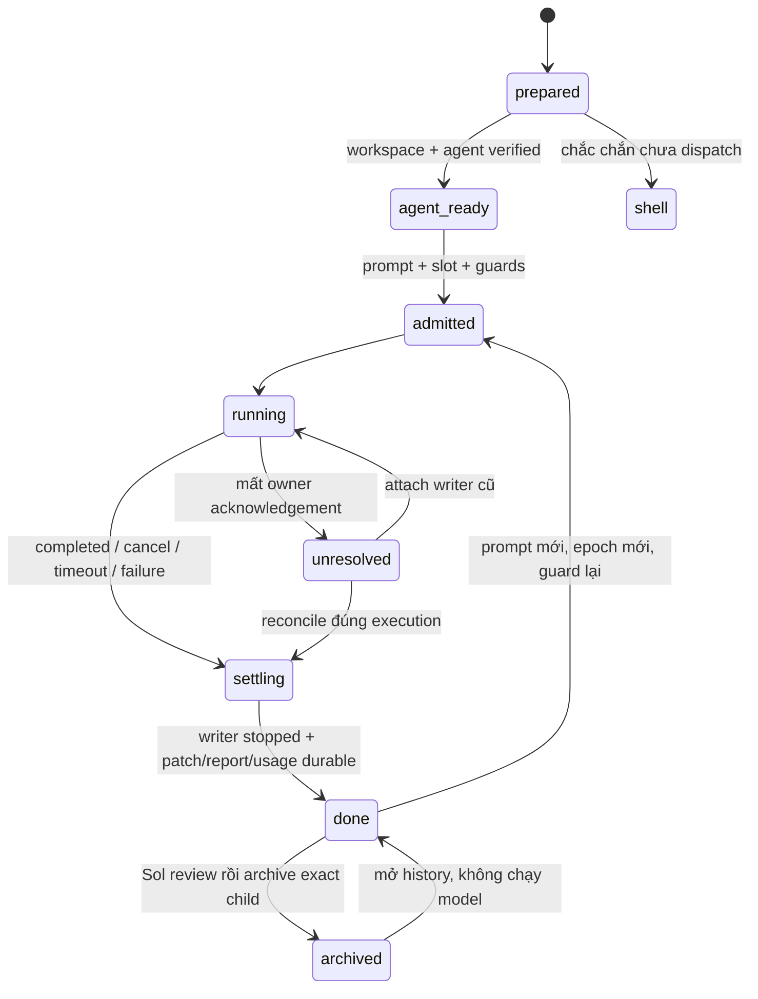

# Hand/subagent thành agent Paseo — spec nháp L2

Ngày nghiên cứu: **09/11/2026**. Trạng thái: **chờ người dùng duyệt; chưa triển khai**. [Plan triển khai](2026-11-09-hand-paseo-agent-plan.md).

## Tóm tắt để duyệt

Mục tiêu cuối là hand/subagent mới chạy thành agent Paseo thật và giữ bảo đảm hand-ext. **Kiến trúc Q1 chưa được người dùng chốt.** Sau khảo sát registry/plugin, khuyến nghị **B — pilot Codex trực tiếp qua bridge**, nếu người dùng chấp nhận phạm vi hẹp và các bảo đảm giảm ở mục 3.4. Nếu giữ đủ guard cho mọi prompt UI và bốn backend là điều kiện ngay bản đầu, chọn **A — ACP gateway bọc runner**. Chưa thấy plugin khảo sát nào thay thế trọn hand-ext; **C chỉ nên tái dùng mẫu**, không cài nguyên bộ orchestration.

Các quyết định và giới hạn chính:

- **Q2 đã chốt:** mỗi hand một workspace riêng trong cùng project; Subagents track/tab của phiên cha là đủ. Không yêu cầu sidebar native lồng. Public create cần `workspaceId` riêng + `callerAgentId=Sol` để giữ đúng cwd worktree [E1–E6,P1].
- **Q4 đã chốt:** done vẫn hiện để review; **Sol archive đúng hand sau review**. Gửi tiếp tự mở lại cùng agent/workspace theo contract revive 0.33.1. Source revive chỉ unarchive workspace sau khi agent đã được mở lại; adapter còn phải nối bước mở agent, admission và epoch mới [E23].
- **B:** chỉ Codex `gpt-6.1-sol low` → `codex-hand`, worktree riêng, bàn giao `.done`, usage từ pinned GPT rollout. DSH/Claude vẫn shell. Không dùng nguyên `side-session start/finish`: mẫu chưa truyền caller và finish đang archive ngay `.done`, trái Q4 [E16,E23].
- **A:** provider ACP `hh-hand-*` đề xuất bọc CLI/parser hiện tại; cần gateway, durable supervisor và admission mới. Giữ được guard cả UI về thiết kế nhưng chưa có runtime chứng minh [E7–E12,E17–E20].
- Native Codex/Claude đã spawn không có API promote đã tìm thấy. Task mới có thể route sang Paseo sau duyệt thay đường native; không migrate child đang chạy [E13]. B không có OS exit CLI như shell, không tự giữ max-turn/token-cap hay cưỡng chế guard/pool khi người dùng gửi trực tiếp UI. Đây là nhượng bộ cần duyệt, không phải parity đã đạt.

Người dùng còn cần duyệt kiến trúc/phạm vi bảo đảm, đổi đường native cho lượt mới, context nếu chọn A, retention và rollout (mục 10). Lượt này chỉ nghiên cứu/viết tài liệu, không cài plugin, sửa code/config hay điều khiển Paseo thật. [Plan](2026-11-09-hand-paseo-agent-plan.md) tách lane theo quyết định chưa chốt.

## 1. Phạm vi và mức chắc chắn

### 1.1 Phạm vi

Áp dụng cho lượt hand-ext của bốn backend và lượt việc trước đây Sol định giao native. Không đổi tài khoản/model/effort, không tạo API key, không bật parallel-subagents. Với repo này, cập nhật người dùng trong phiên và commit **`6d3e9c7d5595426497bcfe9d39dfd041102c0617`** chốt order **codex (`gpt-6.1-sol`, low) → dsh → claude-v1 → claude-v2**. Defaults plugin tại checkout nghiên cứu vẫn dsh trước [E18]; không lấy config worktree cũ để đảo quyết định mới. Với repo khác luôn lấy order hiệu lực của repo đó. Review retry cùng backend một lần rồi backend kế tiếp theo order hiệu lực; không hardcode order trong gateway.

Đây là thiết kế L2 do Sol tự nghiên cứu theo ngoại lệ rõ trong brief. Không giao hand L0/L1, không spawn native, không có usage hand để báo; token/USD/quota của công việc nghiên cứu: `?`.

### 1.2 Quy ước bằng chứng

`Đã đọc source` mô tả implementation cài đặt; `đã probe` chỉ nói hàm/fixture đã chạy; `đề xuất` là contract mới chưa tồn tại. Không suy end-to-end từ unit probe. Mọi bằng chứng được đọc ngày **09/11/2026**.

- `P` = `/Users/anhtp/.nvm/versions/node/v24.19.0/lib/node_modules/@getpaseo/cli`.
- `S` = `P/node_modules/@getpaseo/server/dist/server`.
- `C` = `P/node_modules/@getpaseo/client/dist`.
- `R` = `P/node_modules/@getpaseo/protocol/dist`.
- `D` = `/Users/anhtp/.nvm/versions/node/v24.19.0/lib/node_modules/@deepseek-ai/dsh`.
- `H` = `hybrid-hands/plugins/hybrid-hands` tính từ root repo.

Package metadata xác nhận CLI/server/client Paseo **0.15.0**, DSH **0.2.1-rc.5**. Repo nghiên cứu ở `a76826aa1e3ef0ae2ed10aa9b42d066c70c9a070`. Tài liệu public có thể đi trước bản cài; khi khác nhau ưu tiên source 0.15.0.

| Mã | File:dòng hoặc URL công khai — nội dung đã đối chiếu |
|---|---|
| E1 | `C/daemon-client.d.ts:194–212`: create nhận provider/cwd/env/workspace/caller, agentId, idempotencyKey, autoArchive. `R/messages.js:1440–1473`: env chỉ là string map; agentId tạo mới là UUID. |
| E2 | `S/server/agent/create-agent/intent.js:2–28`: cha từ caller, label cha do daemon stamp; explicit workspace trước caller. `S/server/session.js:3310–3346`: public create thay config.cwd bằng intent.cwd. |
| E3 | `S/server/agent/create-agent/create.js:136–173`: resolver MCP dùng resolvedCwd. `P/dist/commands/agent/run.js:368–408,447–459,506–526`: CLI chọn/tạo workspace và truyền caller. `P/dist/utils/caller-agent.js:1–15`: xác minh PASEO_AGENT_ID trên daemon đích. |
| E4 | `R/agent-labels.js:2–17`: label `paseo.parent-agent-id`. `S/server/agent/agent-storage.js:36–59,303–307`: persisted record giữ labels/workspace/cwd/launchEnv và đường JSON theo agent ID. `S/server/agent/agent-manager.js:3999–4007`: inject PASEO_AGENT_ID của chính child. |
| E5 | `S/skills/paseo/SKILL.md:75–93`; `S/skills/paseo-handoff/SKILL.md:53–63`: child giữ parent dù khác workspace, tab/track, send và archive. [Orchestration](https://paseo.sh/docs/orchestration), [workflows](https://paseo.sh/docs/orchestration-workflows), truy cập 09/11/2026. |
| E6 | [OVERVIEW](../paseo-hh-tree/OVERVIEW.md), dòng 5–16,28–30; `P/node_modules/@getpaseo/plugin/dist/client/contracts.d.ts:146–156`: chỉ sidebar header/footer contributions, không hook sửa dòng native. Bundle `S/web-ui/_expo/static/js/web/index-c26368bf062ddf91b40b9d95aae94799.js:18571,18592,18823`: lọc child theo parent label rồi render SubagentsTrack trong ComposerTrackBar; `:16663` là helper parent label. Không dùng sự hiện diện label làm bằng chứng sidebar lồng. |
| E7 | `S/server/agent/provider-registry.js:484–569`: provider custom `extends:acp` cần command; provider kế thừa claude/codex có runtime/env riêng. `S/server/agent/providers/generic-acp-agent.js:4–24`: generic ACP client. [Custom providers](https://paseo.sh/docs/custom-providers), truy cập 09/11/2026. |
| E8 | `S/server/agent/providers/claude/agent.js:1228–1233,1852–1853,2872–2918`: per-launch env, thinkingOptionId → effort, env overlay. `S/server/agent/agent-storage.js:51`: lưu launchEnv. `S/server/agent/provider-launch-config.js:127–143` và `S/server/paseo-env.js:14–30`: merge env daemon, không tự scrub danh sách API key của hand-ext. |
| E9 | `S/server/agent/providers/codex-app-server-agent.js:387,5834–5866`: CODEX_HOME và app-server. Registry E7 chứng minh alias kế thừa codex khả thi; cấu hình `codex-hand` đang dùng được brief cung cấp, phiên này không mở config tài khoản để xác minh. |
| E10 | `D/node_modules/@deepseek-ai/dsh-acp/README.md:55–80`: initialize/new/resume/close/cancel/config, không session/load hay replay. `D/node_modules/@deepseek-ai/dsh-acp-app/cordis.patch.yml:15–20`: profile shipped trỏ deepseek-official/deepseek-v4-flash, khác route hand-ext. |
| E11 | `D/node_modules/@deepseek-ai/dsh-acp/lib/index.js:625–635`: usage_update chỉ context used/size. `S/server/agent/providers/acp-agent.js:1138–1174,2301–2325`: hỗ trợ resume khi không load; context update khác response.usage. |
| E12 | `P/node_modules/@getpaseo/plugin/dist/server/lifecycle.d.ts:93–150`: turn.before là notification, không request gate. `S/server/plugins/lifecycle/index.js:56–80`: các request gate hiện có. [Plugin hooks](https://paseo.sh/docs/plugins/hooks), truy cập 09/11/2026. |
| E13 | `C/daemon-client.d.ts:984–1001`: list/timeline provider subagents, cancelAgent nhận agent ID; không API promote child. `S/server/agent/providers/codex-app-server-agent.js:2518–2538,3834–3870`: session sở hữu app-server và turn/interrupt. [Agent lifecycle](https://github.com/getpaseo/paseo/blob/main/docs/agent-lifecycle.md), truy cập 09/11/2026; không coi main upstream là contract của bản cài. |
| E14 | `P/dist/commands/agent/send.js:143–165`, `wait.js:110`, `stop.js:43–62`, `archive.js:44–63`: send/wait/cancel/archive. `C/daemon-client.js:4378–4399`: wait trả status/final/error, không OS exit backend. |
| E15 | `S/server/session/workspace-recovery/workspace-recovery-service.js:28–74`: còn directory → unarchive; thiếu local directory → unavailable; chỉ owned worktree có đường recreate. `C/daemon-client.d.ts:969–971`: inspect/restore/resume. |
| E16 | `H/lib/side_session/paseo_bridge.mjs:26–93,267–313,334–355`: mẫu target/exact ID, workspace riêng, giữ ID khi follow-up read lỗi, archive workspace có kiểm private. Chỉ tham chiếu snapshot, không sửa vì sol-ws-hoi đang làm. |
| E17 | `H/lib/hand_ext/run_cmd.py:70–114,231–301,493–535`: preflight/day guard, attempt/run/meta/report/ledger/finalize và slot/exit 7/8. `H/lib/hand_ext/parallel.py:29–69`: scope lock kernel, nhả khi controller thoát. |
| E18 | `H/lib/hand_ext/constants.py:94–105,163–172`: defaults order, cap và exit mappings. `git show 6d3e9c7 -- .claude/hybrid-hands.json`: override repo mới codex trước. |
| E19 | `H/lib/hand_ext/isolation.py:133–166,305–343,372–380`: baseline có dirty changes, worktree, patch/check/apply. `H/lib/hand_ext/runner.py:36–40,63–75,93–108,148–184`: scrub, cap/time, pid, parser/report/OS exit. |
| E20 | `H/lib/hand_ext/backends/claude.py:75–94,143–152`; `backends/codex.py:123–143`; `backends/dsh.py:3–20,60–93`: account env, CLI options, DSH launch tránh .env, route Go và NDJSON token. |
| E21 | `H/lib/hh_ps/tree.py:300–341`; `native_source.py:138–158,204–241`; `run_registry.py:68–104`: identity/parent/token nguồn hiện tại, native aliases và attach riêng. |

Bổ sung vòng 2 (đọc 09/11/2026):

| Mã | Bằng chứng |
|---|---|
| E22 | `P/dist/commands/plugin/index.js:143–150`: install là alias add, hỗ trợ registry/directory/Git/npm. `R/plugin-registry.js:10–26,72–83`: artifact pin và registry mặc định. `S/server/plugins/managed-source/registry.js:8–60`: đọc detail JSON, header install chỉ khi cài. `S/server/plugins/builtin/index.js:4–18`: danh sách builtin. Nguồn public và pin từng plugin ở mục 3.5. |
| E23 | Snapshot nhánh sol-ws-hoi **`2eae0b877a226705cd0209cb012861a4fd6d9100`**: `H/lib/side_session/paseo_bridge.mjs:241–273` revive chỉ unarchive workspace còn directory khi agent đã active; `:278–287` rearchive exact private workspace; `H/lib/side_session/actions.py:392–410` finish gọi cleanup/archive khi `.done`, `:414–454` revive bỏ qua marker cũ. Đọc bằng `git show <hash>:<path>`, không sửa file nhánh đó. `C/daemon-client.d.ts:973` có refreshAgent; `S/server/session.js:3501–3525` refresh có unarchive/reload và có thể interrupt agent đang chạy. Phải precheck exact child archived/quiescent; không refresh parent hay dùng refresh làm polling. |
| E24 | `S/skills/paseo-advisor/SKILL.md:14–39,59–65`, `S/skills/paseo-committee/SKILL.md:13–44`, `S/skills/paseo-plugin/SKILL.md:1–24`: mẫu advisor/committee và authoring, không phải quota/patch runner. [License Paseo](https://github.com/getpaseo/paseo/blob/main/LICENSE), Apache-2.0 cho code của Paseo; third-party giữ license riêng. Truy cập 09/11/2026. |

Các source trong repo có thể mở từ [hand-ext](../plugins/hybrid-hands/lib/hand_ext), [hh-ps](../plugins/hybrid-hands/lib/hh_ps), [bridge mẫu](../plugins/hybrid-hands/lib/side_session/paseo_bridge.mjs). Bàn giao nghiên cứu cwd trước đó: `/Users/anhtp/app/claude-plugins/docs/work-in-progress/handoffs/sol-ws-chung.md`; chỉ dùng làm ngữ cảnh, các kết luận chính đã đọc lại source.

## 2. Paseo orchestration thực sự làm gì

### 2.1 Create, parent và placement

Agent trong Paseo có thể gọi MCP `create_agent`, hoặc shell CLI `paseo run --no-wait`. CLI tự resolve caller từ `PASEO_AGENT_ID` và xác minh trên daemon đích. Public client truyền `callerAgentId` tường minh; không truyền input `parentAgentId` tự chế. Daemon lưu parent bằng label trong record agent, tách biệt với workspace membership [E1–E5].

Nếu bỏ workspace, caller kéo theo workspace **và cwd cha**; explicit workspace kéo theo cwd workspace đó. Bởi vậy `cwd=<hand-worktree>, workspaceId=<parent-workspace>` không giữ được isolation qua public path. MCP có khác biệt resolver, nhưng không chọn internal MCP helper làm cách lách; public tool cũng không hứa input cwd tùy ý. **Khuyến nghị workspace local riêng trỏ đúng `ctx.run_cwd`** của hand-ext, cùng project đã xác minh với cha. Quan hệ parent vẫn giữ [E2–E3]. Nếu repo con của monorepo thì workspace directory là cwd thực thi trong worktree, không tự đổi về worktree root.

### 2.2 Điều khiển và kết thúc

`send` gửi lượt tiếp; `wait` chờ kết thúc lượt; `stop` gọi cancel lượt đang chạy, idle là no-op. Archive là soft archive, CLI thường yêu cầu stop trước hoặc force. Client `waitForFinish` không cung cấp OS exit của executor. Agent idle sau lượt không có nghĩa patch đã apply/report đã durable, cũng không tự đồng nghĩa đã archive [E14]. Gateway chỉ trả ACP prompt thành công **sau** finalization; caller vẫn đọc outcome riêng.

Skill Paseo đã cài hướng dẫn brief tự chứa, chọn profile theo notes, isolation bằng workspace, worker giữ trong track cha. Đó là mẫu tham khảo; policy model/account/quota của hand-ext vẫn có ưu tiên, không tự lấy profile thay kết quả pick [E5, E17]. MCP injection không phải điều kiện bắt buộc của hướng client/CLI; không bật nó trong task này.

### 2.3 Hiển thị đã được chốt

**Q2:** mỗi hand có workspace riêng dưới cùng project, agent mở thành tab ở workspace đó và xuất hiện ở Subagents track phiên cha; không cần sidebar lồng. Source đã chứng minh parent track vẫn giữ khi child ở workspace khác [E5–E6]. Nghiệm thu live còn phải nhìn app thật để xác nhận workspace row/project, tab và track đúng. Cây phiên hybrid-hands vẫn gắn đúng parent canonical; không sửa native hierarchy hay bundle Paseo.

## 3. So sánh kiến trúc và ánh xạ backend

### 3.1 Ba lựa chọn cần duyệt

Nhãn **A/B/C dưới đây thay nhãn phương án của bản 723d193**. Ước lượng là đánh giá thiết kế của Sol theo phạm vi file trong plan, đơn vị ngày công kỹ thuật gồm review/test hẹp, không phải thời gian lịch hay cam kết; chưa gồm upstream Paseo và chờ live/account.

| Phương án | Cách chạy và phạm vi | Giữ / mất chính | Công sức ước lượng | Khuyến nghị |
|---|---|---|---|---|
| **A — ACP gateway** | Provider `hh-hand-*` mới, Paseo → gateway tin cậy → runner CLI hiện có cho cả bốn backend | Giữ patch/guard/OS exit/ledger nếu làm đủ; phải viết lại admission/pool/crash mapping; không hứa backend context resume | **8–15 ngày công**; nhiều rủi ro nhất ở supervisor/recovery/ACP | Chọn nếu parity cả bốn backend và mọi prompt UI là gate bản đầu |
| **B — MVP Codex qua bridge** | Client tạo `codex-hand` low trong worktree riêng, caller Sol; controller đọc `.done` + rollout; DSH/Claude giữ shell | Nhẹ hơn, context Codex tự nhiên; phải nối patch/pool/review lifecycle; mất OS exit CLI, guard/cap trực tiếp UI chưa enforce | **3–5 ngày công** cho controller/bridge/usage + fixture/pilot; không bao gồm khôi phục đầy đủ mọi bảo đảm A | **Khuyến nghị pilot trước**, chỉ sau duyệt giới hạn mục 3.4 |
| **C — dựa plugin có sẵn** | Firstmate gần mẫu workspace-per-worker; Playbooks có DAG/parent, SLP có placement; vẫn dùng full Paseo agents | Tái dùng flow/UI/state, nhưng chưa thấy hand-ext guards/ledger/shared pool/patch parity; license/capability phải kiểm theo pin | **5–10 ngày công** cho một fork nhỏ tích hợp; parity đầy đủ chưa đủ dữ liệu ước lượng và có thể ngang/vượt A | Không chọn làm nền MVP; học mẫu, tránh thêm một manager/policy cạnh Sol |

Shell hiện tại là fallback, không được quảng bá là agent Paseo. Loại cách tạo agent quan sát trong khi shell writer chạy độc lập: stop/archive không sở hữu writer và dễ đếm trùng. **Exactly one execution owner** áp dụng mọi phương án; không gọi lồng `hand-ext run` từ executor hay giữ hai slot.

### 3.2 Backend → provider

Provider `hh-hand-*` dưới đây là tên **đề xuất chưa đăng ký**. Đều `extends:acp`, dùng cùng executable gateway với backend/account cố định. Capability phải được cài qua công cụ/thiết lập chính thức trong giai đoạn triển khai đã duyệt; không tự sửa host config ở lượt tài liệu này.

| Backend | Provider trực tiếp Paseo | A — gateway | B — pilot / fallback |
|---|---|---|---|
| codex, gpt-6.1-sol low | `codex-hand` kế thừa codex, CODEX_HOME `~/.codex-hand`, thinkingOptionId low [E7,E9] | `hh-hand-codex`; giữ codex backend, không đổi home/config | **codex-hand** qua adapter mới, chưa kiểm live; thiếu capability/strict option thì shell trước dispatch |
| claude-v1, Opus 5.5 low | `claude` + per-agent env `CLAUDE_CONFIG_DIR=~/.claude`, hoặc derived provider riêng [E7–E8] | `hh-hand-claude-v1`; guard ≥5%/ngày và thiếu nguồn đều chặn | **Shell**; account env direct chưa chứng minh scrub/parity, không bật trong B |
| claude-v2, Opus 5.5 low | `claude` + `CLAUDE_CONFIG_DIR=~/.claude-hand`, hoặc derived provider riêng [E7–E8] | `hh-hand-claude-v2`; cùng policy đúng account | **Shell**; chưa bật direct trong B |
| dsh, deepseek-v4.1-flash off | Custom ACP: command trỏ wrapper `dsh --profile acp`, không phải provider dsh builtin [E7,E10] | `hh-hand-dsh`; giữ headless NDJSON/Go route/sandbox hiện tại | ACP thật có sẵn nhưng route shipped sai mục tiêu, usage chỉ context [E10–E11]. **Giữ shell hiện tại** cho tới gateway đạt parity; không chỉ đổi command sang dsh ACP |

Model IDs/effort gateway là giá trị canonical của hand-ext. Không dùng model opaque của DSH ACP hay tên provider Paseo làm key pricing. V1/v2 không hoán đổi khi guard chặn. Env direct chỉ là overlay lên env daemon; việc xóa key ở frontend không xóa key của daemon. B dùng provider trực tiếp nên cần launch wrapper scrub đúng BLOCKED_ENV, không gửi credential qua env request (launchEnv được lưu) [E8,E20].

### 3.3 Native Sol và Claude Code

Native Codex do `spawn_agent` hiện tại tạo là thread do provider/app-server quản lý, có provider-subagent list/timeline; không phải daemon agent độc lập. API đã đọc không có promote/reparent child thành full Paseo agent, cũng không có cancelAgent bằng native child ID [E13]. Không thể chuyển child đang chạy sang gateway mà giữ nguyên cam kết không trùng writer. Giữ native cũ ở hh-ps, không fake run/meta/report/ledger cho chúng.

**Khuyến nghị:** sau duyệt đổi đường native, task mới trước đây định spawn native được giao qua dispatcher Paseo với `origin=native-intent`; pick vẫn đúng backend/model/effort/account và brief tự chứa. Lượt này là **managed task mới**, không còn là provider-native Codex theo Ngoại lệ A. A có run/meta/report/ledger runner thật một lần; B có handoff/controller record và rollout, không giả tạo ledger/native run từ metadata. Nếu không duyệt thay semantics, giữ native như hiện tại và ghi rõ không đạt mục tiêu stop/archive riêng như phiên. Không intercept tool runtime, không bật parallel-subagents.

Claude Code `hybrid-hands:hand` cũng là provider-native, không tự có agent Paseo ID. Đưa **task mới** sang gateway Claude đúng account là thay đường thực thi, không lift nguyên subagent/hội thoại. Conversion child đang có và thay implementation Agent tool ngoài phạm vi MVP [E5,E13]. Đây là giới hạn API khảo sát, không khẳng định mọi phiên bản tương lai đều không làm được.

### 3.4 Contract B — MVP Codex trực tiếp, mức bảo đảm hẹp

B tái dùng **cơ chế** side-session (public client, workspace/project, codex-hand, target/exact IDs, pin rollout, handoff), không gọi `side-session start` để mở thêm Sol và không sửa `lib/side_session/*`. Adapter hand mới phải thêm `callerAgentId`, placement tại hand worktree và lifecycle review riêng. Start mẫu chưa truyền caller; `.done` của side-session hiện kéo theo archive ngay, nên không copy nguyên đường start/finish [E16,E23].

Luồng đề xuất: pick/preflight theo order hiệu lực → reserve shared pool → chuẩn bị worktree/dirty baseline bằng isolation hiện có → ghi intent/key → tạo workspace cùng project + child codex-hand low, verify parent/cwd → gửi brief tự chứa kèm đường handoff và marker epoch → chờ handoff + `.done` hợp lệ **và** xác nhận turn/writer đã dừng → tạo outcome/report controller, patch/check/apply một lần → giữ hiện `awaiting_review` → Sol review rồi archive đúng child. Agent idle hoặc `.done` đơn lẻ không chứng minh thành công; nếu provider/OS không chứng minh được hết writer thì B giữ unresolved, không apply/fallback và chưa đạt gate pilot; side-session slot tối đa 6 không thay pool hand 1..4. Không tự tạo project khi chưa xác minh mapping.

| Bảo đảm | B giữ thế nào / giới hạn phải duyệt |
|---|---|
| Worktree + patch | Giữ isolation.prepare/finalize và dirty baseline **nếu adapter nối lại**; side-session bridge không tự sinh/apply changes.patch hand-ext. Patch xung đột giữ artifact, không ghi đè repo nguồn. |
| Order/account/model/effort, guard quota/ngày, exit 7 | Giữ pick/preflight trước dispatcher send, Codex home cố định. DSH/Claude shell vẫn wrapper enforce. Không dùng provider lỗi để tự đổi backend. **Send trực tiếp app không được guard cứng** bởi wrapper. Env daemon cần scrub bằng launch wrapper; không gửi key/env nhạy cảm trong request. |
| Shared max_parallel, exit 8 | Controller phải đăng ký managed/native/shell và giữ reservation qua ACK mất/daemon còn writer; không dùng lock frontend hiện tại đơn độc. **Ngoài dispatcher/UI trực tiếp không cưỡng chế được cap trước spawn**. Pilot yêu cầu giao việc/gửi tiếp qua controller; nếu cần chặn mọi UI thì B không đạt. |
| Timeout/stop | Cần watchdog durable giữ quyền sở hữu, cancel đúng child và xác nhận quiescent trước patch/nhả slot. Chưa có watchdog thì chưa quảng bá timeout parity. Direct provider không giữ sẵn max-turn/token-cap/CLI sandbox flags tương đương; phải map/test hoặc ghi unsupported, không bỏ qua option. |
| OS exit/report | Không có exit process backend như CLI runner: wait là turn outcome [E14]. Giữ exit 7/8 ở frontend admission; backend_exit_code=null khi chưa biết, không bịa exit 0. Report controller/handoff mới có provenance, outcome completed/failed/cancelled/timeout/unknown riêng. |
| Tokens/USD~/quota | Pin đúng provider thread, đọc token delta rollout GPT, giá canonical; thiếu token/model/price giữ ?. Không thêm token ledger hand-ext cho native-origin, không cộng rollout + projection + ledger; quota vẫn nguồn rate_limits hợp lệ, không suy từ token/USD. Shell backend khác giữ ledger hiện tại. |
| Resume/review | Cùng Codex conversation có thể tiếp tục theo persistence provider, cần verify thread live. `.done` theo epoch mới, idle không thay done; giữ hiện sau done, archive sau Sol review, revive cùng IDs. Không tự dọn worktree. |

Để **không thay âm thầm bảo đảm hand-ext**, khuyến nghị pilot B là mode opt-in riêng cho managed Codex/native-intent; `hand-ext run` shell và options nghiêm ngặt vẫn giữ nguyên. Nếu được giao token cap/max-turns hay yêu cầu guard mọi UI mà B chưa có capability, `auto` fallback shell **trước dispatch**; `required` trả unsupported. Không công bố cả bốn backend thành Paseo trong B. Thăng B lên parity cần host admission/gateway đã chứng minh, không chỉ thêm lời nhắc vào skill.

### 3.5 Khảo sát registry, plugin và skill có sẵn

**Nguồn và phạm vi (09/11/2026):** đã xem [directory chính thức](https://paseo.sh/plugins), [nhóm orchestration](https://paseo.sh/plugins/category/orchestration?window=all), [plugin reference](https://paseo.sh/docs/plugins/reference), và repository [getpaseo/plugins tại snapshot c64d118](https://github.com/getpaseo/plugins/tree/c64d1181b85d1dcdce552d50496ad1a88d749f9e). Registry mặc định CLI là `https://plugins.paseo.sh`; `install` alias `add` đọc `/plugins/<owner>/<slug>.json`, không phải chạy tìm kiếm rồi install [E22]. [Protocol registry tại pin](https://github.com/getpaseo/plugins/blob/c64d1181b85d1dcdce552d50496ad1a88d749f9e/PROTOCOL.md) mô tả detail JSON và artifact npm integrity/Git commit cố định. Registry chính thức chứa cả plugin cộng đồng, không có nghĩa code do Paseo viết hoặc đồng giấy phép.

GET trực tiếp `plugins.paseo.sh/index.json` bằng HTTP client trả **403**; đã thay bằng directory public + 10 record ở repo registry pin trên + source repo từng plugin. Không dùng install header, không gọi install/reload, không chạy code tải về. Đây là khảo sát có chọn lọc các dispatcher/workflow và plugin hiển thị/lifecycle liên quan, **không kết luận đã audit toàn bộ registry**. Git source pin dưới đây là artifact commit với Git; hai npm package dùng version/integrity từ registry và commit nguồn được record khai báo, chưa tải/đối chiếu byte npm hay runtime compatibility 0.15.0.

**Mẫu chính thức đóng gói trong Paseo 0.15.0:**

| Thành phần | Tạo child và có thể tái dùng gì | Giới hạn / giấy phép |
|---|---|---|
| `paseo` + `paseo-handoff` | `create_agent`/CLI, explicit workspace giữ parent; handoff skill chọn workspace/worktree, brief tự chứa. Tái dùng làm policy mẫu cho B, client/caller/placement vẫn adapter riêng [E3,E5]. | Handoff là chuyển việc cho người dùng tiếp tục, không tự là hand-ext waiter/patch/slot. Code upstream Apache-2.0, phải giữ NOTICE/license khi copy; package third-party có license riêng [E24]. |
| `paseo-advisor`, `paseo-committee` | Chọn profile, create child read-only, wait/synthesize; committee hai góc nhìn [E24]. | Học create/wait/archive; không áp cơ chế hand tự review hay tự chọn profile thay pick; không có quota/patch contract. Cùng license upstream. |
| `paseo-plugin` và orchestration workflows | Skill authoring plugin; [workflows public](https://paseo.sh/docs/orchestration-workflows) có ví dụ worktree-per-task, follow-up, stop và track/tab. | Là recipe/docs, không phải plugin gateway thực thi đã có. Đọc như nguồn nghiên cứu, không invoke workflow. |
| Builtin provider/usage/worktree-include | Danh sách source chỉ gồm các provider, usage-source, worktree-include [E22]. | Không thấy builtin generic hand dispatcher trong danh sách này. Usage account không thay ledger/token per-run. Không đổi provider config để thử. |

**Plugin cộng đồng đối chiếu source:** mỗi hàng dẫn source và license tại commit đã đọc; ngày truy cập chung **09/11/2026**. Không có kết luận “tái dùng được” đồng nghĩa đã test hoặc đã có quyền cài.

| Plugin / pin khảo sát | Làm gì, tạo agent con thế nào | Tái dùng/fork cho hand-ext và giấy phép |
|---|---|---|
| **[gpambrozio/firstmate](https://paseo.sh/plugins/gpambrozio/firstmate)**, npm 0.4.0, source 5989657 | First-mate manager + board; charter dùng MCP create_workspace(worktree) rồi create_agent explicit workspace/model/effort/notify. [Source](https://github.com/gpambrozio/paseo-plugins/blob/5989657e7a37bbbd1a582257d6acf397289750be/firstmate/templates/data/charter.md#L269-L289) | Gần nhất mẫu mỗi worker workspace; có thể học placement/board. Charter không cap concurrency và không tự serialize cùng file, trái pool repo; guard phần lớn là prompt, phải thay routing/review/quota. [MIT](https://github.com/gpambrozio/paseo-plugins/blob/5989657e7a37bbbd1a582257d6acf397289750be/firstmate/LICENSE). |
| **[lerenn/playbooks](https://paseo.sh/plugins/lerenn/playbooks)**, Git 1480de9 (v0.23.1) | YAML DAG, roles, loop, human gates, timeout; runtime tạo workspace.agents.create với parent=manager, rồi send; step cùng run workspace. [Source](https://github.com/lerenn/paseo-playbooks/blob/1480de9c8f1af83d3fd8e23b07066f4dc0d53ca1/server/runtime.ts#L550-L575) | Có thể fork attempt/state/timeout, nhưng phải đổi placement mỗi hand và gắn guards/pool/patch; thừa DAG cho MVP. [Package khai MIT](https://github.com/lerenn/paseo-playbooks/blob/1480de9c8f1af83d3fd8e23b07066f4dc0d53ca1/package.json#L36); không thấy LICENSE riêng tại pin, cần làm rõ notice trước vendor. |
| **[duongvm57/slp](https://paseo.sh/plugins/duongvm57/slp)**, Git 43452ab (v0.9.1) | Supervisor/Lead/Peer desk, assignment/review/evidence; host adapter chuyển parent→callerAgentId, placement tạo agent trong workspace đã kiểm. [Host](https://github.com/duongvm57/paseo-slp-plugin/blob/43452ab06793c7ad6318bb01d9a74652f81727f1/plugin/server/desk-task-execution-host.ts#L26-L27), [placement](https://github.com/duongvm57/paseo-slp-plugin/blob/43452ab06793c7ad6318bb01d9a74652f81727f1/plugin/server/desk-placement.ts#L281-L304) | Học exact placement/recovery; whole plugin sở hữu role pool và cấu hình provider/MCP khác repo, cần viết tích hợp lớn. [MIT](https://github.com/duongvm57/paseo-slp-plugin/blob/43452ab06793c7ad6318bb01d9a74652f81727f1/LICENSE); không kích hoạt/setup. |
| **[gyuha/agent-team](https://paseo.sh/plugins/gyuha/agent-team)**, Git 50e8449 | Tạo orchestrator bằng workspace.agents.create; worker được chỉ dẫn dùng Paseo CLI/MCP, chung workspace, lưu team roles ([README](https://github.com/gyuha/paseo-agent-team/blob/50e84497b220ef44e1986f3328483629aa9fbadf/README.md#L98)). [Source](https://github.com/gyuha/paseo-agent-team/blob/50e84497b220ef44e1986f3328483629aa9fbadf/server/team.ts#L345) | Chỉ tham khảo flow; phải đổi workspace/caller/pool/guard và không thêm manager cạnh Sol. [Tree/package tại pin](https://github.com/gyuha/paseo-agent-team/tree/50e84497b220ef44e1986f3328483629aa9fbadf) không thấy LICENSE hoặc package license: **chưa rõ giấy phép, không chọn copy/fork code**. |
| **[ssime-git/agent-teams](https://paseo.sh/plugins/ssime-git/agent-teams)**, Git 6f9006d (v0.1.2) | Plan/Build/Test/Review persistent; SDK agents.create có idempotency role/cycle, chung workflow workspace, object này không đặt parent. [Source](https://github.com/ssime-git/paseo-agent-teams/blob/6f9006d273ec35235c4bb51e96cb469e0a3422fb/server/runtime.ts#L65-L112) | Học idempotency/role state; chưa chứng minh child của Sol, phải thêm caller và worktree từng hand, giữ Sol tự review. [MIT](https://github.com/ssime-git/paseo-agent-teams/blob/6f9006d273ec35235c4bb51e96cb469e0a3422fb/LICENSE). |
| **[omercnet/agent-crew](https://paseo.sh/plugins/omercnet/agent-crew)**, npm 4.1.2, source 4c6987e | Explorer tree cho managed agents đã có, controls follow-up/redirect/archive, loại archived; không chuyển shell/native thành agent thật. [Source](https://github.com/omercnet/paseo-plugins/blob/4c6987e4c51314032866c723d97d30d571c72344/agent-crew/OVERVIEW.md#L1-L16) | Học UI/identity nếu cần, không là executor/admission; Q2 đã đủ nên không cần thêm panel tương tự Cây phiên. [MIT](https://github.com/omercnet/paseo-plugins/blob/4c6987e4c51314032866c723d97d30d571c72344/agent-crew/LICENSE). |
| **[sm1ee/session-janitor](https://paseo.sh/plugins/sm1ee/session-janitor)**, Git e901fef (v0.1.6) | Archive finished subagents và retention cleanup, kiểm family/children/target; không tạo child. [Source](https://github.com/sm1ee/paseo-session-janitor/blob/e901fef9b00af045ca5a0c4fa74c4d75951d1d30/server/service.ts#L144-L171) | Học guard exact target; **không bật auto-archive** vì Q4 Sol archive sau review, không theo idle/retention của plugin. [MIT](https://github.com/sm1ee/paseo-session-janitor/blob/e901fef9b00af045ca5a0c4fa74c4d75951d1d30/LICENSE). |
| **[epistex-dev/parent-wake](https://paseo.sh/plugins/epistex-dev/parent-wake)**, Git 7a4d46a (v0.3.0) | Hook permission/turn finished rồi parent.send system message; không tạo worker. [Source](https://github.com/epistex-dev/paseo-subagent-notifications/blob/7a4d46a92be4bcae93a69ad384caf33c185e66e2/index.server.ts#L18-L65) | Học notification/dedup nếu thực sự thiếu, không thay .done/report/guard. Không bật gửi thông báo trong nghiên cứu này. [MIT](https://github.com/epistex-dev/paseo-subagent-notifications/blob/7a4d46a92be4bcae93a69ad384caf33c185e66e2/LICENSE). |
| **[lanioque/agent-tree](https://paseo.sh/plugins/lanioque/agent-tree)**, Git 85aee7c | Đọc Claude native subagents/workflow/background metadata và transcript để vẽ tree; không promote thành daemon child. [RPC source](https://github.com/Lanioque/paseo-agent-tree/blob/85aee7c4690daeacea4e6eb40cf7ddf8077c34fc/index.server.ts#L1-L12), [reader](https://github.com/Lanioque/paseo-agent-tree/blob/85aee7c4690daeacea4e6eb40cf7ddf8077c34fc/server/transcript.ts) | Học view, không đạt stop/archive riêng; không tái dùng đọc nội dung thật cho hand nghiên cứu. [MIT](https://github.com/Lanioque/paseo-agent-tree/blob/85aee7c4690daeacea4e6eb40cf7ddf8077c34fc/LICENSE). |
| **[sbhas2k/workflow-progress](https://paseo.sh/plugins/sbhas2k/workflow-progress)**, Git f433cbe | Cards tiến độ Claude Workflows từ journal/transcript, native subagents nằm trong cùng Claude session; không create agent độc lập. [Source](https://github.com/sbhas2k/paseo-plugins/blob/f433cbe0acd49262a46f186a524d2d527219685a/workflow-progress/index.server.ts#L10-L45) | Không thay executor Codex/hand-ext; chỉ mẫu presentation và vẫn cần metadata-only adaptation. [MIT](https://github.com/sbhas2k/paseo-plugins/blob/f433cbe0acd49262a46f186a524d2d527219685a/workflow-progress/LICENSE). |

**Đánh giá C:** Firstmate gần placement yêu cầu nhất, Playbooks mạnh state workflow, SLP mạnh evidence/placement; cả ba vẫn cần adapter hand-ext và thay policy. License permissive không chứng minh guard/capability. Khuyến nghị tái dùng recipe chính thức cho B và một số pattern có license rõ, giữ dispatcher của hybrid-hands là chủ admission; không fork cả control plane vào MVP. Nếu người dùng chọn C, cần spike riêng pin/version/compatibility/license trước code; không lấy main của plugin thay artifact pin đã khảo sát.

## 4. Contract đầy đủ cho A — gateway ACP

### 4.1 Quyền sở hữu và identity

Đề xuất record điều khiển durable riêng, khác registry best-effort hiện có [E17,E21]. Trường mới thêm cuối với default ở dataclass công khai khi cần. Một logical invocation có `invocation_id`; mỗi backend attempt có `run_id`, `attempt_id`, một Paseo agent ID. Retry/fallback khác backend tạo attempt/agent mới sau khi attempt trước chắc chắn quiescent; chỉ một attempt sở hữu writer tại một thời điểm. Cùng agent được mở lại để xem lịch sử; gửi tiếp tạo `execution_epoch` mới với backend cố định.

Record gồm `schema_version`, `scope_id` của Sol, `parent_session` canonical, `parent_paseo_agent_id`, `target_key`, `workspace_id`, `agent_id`, `origin`, `backend/account_alias`, `model/effort`, `transport`, source cwd, isolated cwd, baseline/patch paths, trạng thái/epoch, `prompt_receipt`, lease/process identity, timestamps, status, nullable backend exit code và nguồn token. Không ghi auth/env values/prompt vào labels. Nhãn chỉ chứa ID/loại công việc được phép công khai. Scope giới hạn pool, không làm parent ID.

Frontend cấp UUID/idempotency key và ghi intent **trước request create**. Gateway phải đối chiếu record authoritative, target/cwd/parent/backend/account/epoch, không tin labels/path do prompt cung cấp. Resume ACP dùng session ID này để mở record cũ, không tự chạy prompt. Persistence phải hoạt động qua runtime idle cleanup/restart; không phụ thuộc gateway luôn còn sống [E1,E4,E11].

Phạm vi file được giao là ràng buộc điều phối: việc cùng file/phụ thuộc phải tuần tự, kể cả khác worktree hay khác agent ID. Admission lưu phạm vi ghi và chặn xung đột đã khai báo; patch apply giữ `git apply --check`, không force ghi đè thay đổi phát sinh ở source repo. Giữ các thay đổi chưa commit của người khác.

### 4.2 Admission và pool

Mỗi `session/prompt`, kể cả từ app/CLI/MCP, phải qua gateway admission: khóa epoch + kiểm còn writer → đọc policy hiệu lực → pick/preflight/guard lại → giữ slot scope → chạy đúng backend. Backend/account cố định của agent không khớp pick thì từ chối, trả lý do an toàn để dispatcher xử lý; không âm thầm đổi account trong phiên. Metadata/model/effort UI không được đổi policy; catalog chỉ quảng bá cấu hình hợp lệ, option lạ bị từ chối trước executor.

Pool chung `ext_hand.max_parallel` 1..4 gồm managed Paseo, hand shell và legacy native đang chạy. `parallel.py` hiện chỉ khóa tiến trình hand-ext; chưa có admission native chung bằng kernel [E17]. Cần adapter đăng ký native + shared supervisor/lease reconciliation. Khi vẫn cho phép native tool ngoài dispatcher, không thể cưỡng chế cap tuyệt đối từ gateway: discovery chỉ phát hiện sau spawn. **Gate release:** mọi task mới đi dispatcher; legacy đang chạy được đối chiếu trước giữ slot, unknown chiếm chỗ bảo thủ tới khi reconcile. Không gọi đây là bảo đảm đã có.

Không nhả slot vì frontend thoát hay mất kết nối trong khi daemon còn writer. Đề xuất supervisor thực thi giữ khóa xuyên suốt executor và finalization, process identity chống PID reuse; dispatcher kiểm durable unresolved record trước admission. Gateway EOF/crash phải cancel/reap process group do nó sở hữu; nếu chưa chứng minh dừng được thì giữ reservation unresolved. Không dùng lock-file unlink hay TTL hết hạn làm bằng chứng writer đã chết.

### 4.3 Ma trận bảo đảm

| Bảo đảm hiện tại | B — direct Codex cần bổ sung | A — gateway phải bảo toàn |
|---|---|---|
| Worktree sạch, mang dirty baseline an toàn, patch/apply | Cần nối lại controller | Dùng isolation.prepare/finalize; chỉ một owner apply, xung đột giữ patch; không copy secret/ignored [E19] |
| Slot/exit 8 | wait/idle Paseo không thay admission | Shared supervisor; full trước dispatch → exit 8, không đổi backend; unknown không giải phóng |
| Pick/order/quota/guard v1/exit 7 | Paseo create không tự chạy hand-ext guard | Giữ preflight đúng account; hết order → 7 + doctor metadata an toàn; không dùng lỗi daemon làm lý do skip backend [E17–E18] |
| Timeout/token cap/max turns/sandbox/browser | Phải map khả năng provider và kiểm tương đương | Giữ RunSpec + runner backend options; timeout ngoài frontend, cancel quiescent; token cap theo semantics polling hiện tại, không hứa trần tuyệt đối [E19–E20] |
| DSH capacity retry/patch-preserve | B giữ shell nên giữ classifier hiện tại | Giữ capacity.py/run_cmd policy, order repo mới; không đổi thành quota hay retry vô hạn |
| OS exit/status/report | wait không có backend exit [E14] | Lưu OS exit executor thật, status nguyên nhân, report durable; exit gateway khác exit backend. Chưa quan sát thì null |
| Token ledger/USD~ | Codex dùng rollout; không có ledger runner tự đi theo | Giữ parser/poll nguồn backend và canonical pricing; ledger exactly once theo run/epoch, không ghi thêm ledger từ ACP |
| Stop/archive/reopen | Paseo có lifecycle nhưng không điều phối patch/slot của hand-ext | Cancel chặn admission mới, dừng writer, drain/finalize trước settle; reopen history không model; prompt mới guard lại |

**Mất hoặc chưa có:** B có giới hạn cụ thể ở mục 3.4; không mặc định kế thừa contract A chỉ vì dùng chung tên hand. A giữ được về thiết kế nhưng cần làm mới control/recovery/pool/ACP mapping; chưa chứng minh runtime. A không giữ sẵn native backend context qua send tiếp, không nâng native đang chạy. Mọi hướng giữ worktree lâu hơn để reopen.

## 5. Vòng đời sidebar, archive, reopen và workspace

Tên agent đề xuất `HAND <backend> · <nhãn việc ngắn> · <run-id ngắn>`; origin native-intent có thể dùng `TASK` để tránh gọi nhầm là native runtime. Không đưa prompt, path khách hàng hay giờ bắt đầu lên tên. Agent Paseo mang parent canonical; workspaces thuộc cùng project đã xác minh, không đoán bằng cwd đơn thuần. Không dùng background=true vì có thể làm child biến khỏi UI; phải kiểm workspace/parent background inheritance trước launch [E2,E5].

**Q4 đã chốt:** khi done giữ agent và workspace active tới review, sau đó Sol archive exact child; không tự force archive running. Archive agent không phải xóa worktree. Giữ worktree để lịch sử/reopen còn cwd hợp lệ. Archive workspace riêng chỉ sau xác minh toàn bộ membership kể cả archived siblings và không có writer/terminal đang dùng; tuyệt đối không archive workspace/project/agent cha [E14–E16].

Gửi tiếp phải tự mở lại **cùng agent/workspace**, khớp revive 0.33.1 của sol-ws-hoi [E23]. Nối đầy đủ: reconcile đúng target/ID và không còn writer → inspect recovery chỉ chấp nhận cwd còn nguyên/action unarchive → mở agent bằng public API bảo toàn ID → revive workspace còn archived → admission/epoch mới → send. `revive` không tự mở agent đang archived; `refreshAgent` có thể interrupt/reload nên chỉ dùng sau precheck, không coi là read-only. Thiếu khả năng mở cùng ID thì báo blocked, không tạo agent thay thế hoặc shell writer mới. Lịch sử đơn thuần không gửi model prompt.

Không copy lifecycle `side-session .done → finish → archive`: trái Q4. Controller hand giữ `awaiting_review`, patch/report durable và writer quiescent rồi nhả slot; archive sau review đúng ID. Marker `.done` mới phải gắn epoch/nonce và có handoff tương ứng; gửi tiếp không được để marker cũ hoàn tất lượt mới. Reuse bridge/recovery sau khi hợp nhất nhánh owner, không sửa `lib/side_session/*` trong implementation hand riêng [E16,E23].

Workspace local trỏ worktree do hand-ext sở hữu: nếu đã cleanup directory thì Paseo recovery báo unavailable, không tự tạo lại như owned Paseo worktree [E15]. Vì vậy MVP **không tự dọn** directory sau done/archive. Gói cleanup tùy chọn sau: cần snapshot/baseline/patch durable và kiểm không reference/dirty/unapplied; dọn thì đánh dấu history-only, cấm tiếp tục ghi trên cwd mất. Không xóa/di chuyển output/llm. Không đặt retention ngày tùy tiện trước khi người dùng chốt.

Với **A**, follow-up là task tự chứa mới trong cùng lịch sử Paseo; không hứa resume CLI context. Với **B**, provider codex-hand có đường session/persistence của Codex [E9,E13], nên có thể tiếp tục hội thoại; vẫn cần admission, baseline/patch delta và `.done` epoch mới, kiểm live giữ đúng thread. Cả hai không apply patch cũ lần hai. B không thể cưỡng chế luồng này nếu người dùng send trực tiếp UI ngoài controller: nhận diện và reconcile; muốn guard cứng phải chọn A hoặc có host gate mới đã chứng minh.

## 6. Fallback không tạo writer trùng

| Tình huống | Hành vi đề xuất |
|---|---|
| Trước mutation, daemon không chạy/thiếu provider/capability hoặc không resolve được parent đúng target | `auto` về shell cùng backend/policy và ghi transport=shell, lý do an toàn; không khẳng định có dòng Paseo. `paseo-required` trả lỗi transport riêng, không mượn exit 7/8 |
| Workspace đã tạo nhưng agent chắc chắn chưa tạo/chưa gửi prompt | Reconcile resource ID; shell được chạy nếu chứng minh chưa có writer, giữ record cleanup workspace; không cleanup parent |
| Timeout create, thiếu ID hoặc reply mất | Dùng UUID/key/label invocation + target đã lưu để fetch/reconcile cả archived; không tạo lại hay shell trong trạng thái ambiguous |
| Agent đã có, send mất ACK / daemon restart / UI gửi tiếp | Reconcile receipt + epoch + supervisor. Attach execution cũ; không gửi lại prompt hay chạy backend khác vì im lặng |
| Cancel chưa được xác nhận quiescent | Giữ unresolved, không finalize/apply/nhả slot/fallback; timeout bounded cho thao tác kiểm, báo cần reconcile |
| Backend thật quota/login/capacity | Sau settlement áp policy hand-ext hiện có theo order repo, giữ các attempt riêng; không gộp lỗi transport thành quota |

Đề xuất settings vận chuyển `shell | auto | paseo-required` là contract mới cần code/schema/tài liệu sau duyệt. Default trong code lúc rollout đầu: shell; bật auto cho repo pilot đã duyệt sau capability gate. Không sửa config hiện tại trong task này. Fallback shell từ native-intent là lượt managed mới; nếu policy yêu cầu native theo Ngoại lệ A thì trả giới hạn cho caller, không tự đổi semantics.

## 7. Token, hh-ps, Cây phiên và statusline

Nguồn trạng thái mới là record controller (A supervisor/runner; B epoch/handoff/quiescence) và metadata Paseo, nối bằng bảng identity explicit. Một execution được thấy dưới dạng hand run + Paseo agent + rollout thì **chỉ có một dòng canonical**, không thêm Session thứ hai chỉ vì có agent ID. Dùng khóa `(target_key, agent_id, execution_epoch)` ánh xạ run/attempt/thread/provider session; native legacy vẫn dùng thread metadata cố định như E21. Không đoán cha theo scope/cwd, không gán native parent_thread_id giả cho Codex exec do gateway chạy.

**A:** hand-ext ledger/registry là nguồn usage managed execution, timeline là projection. **B:** pinned GPT rollout là nguồn token của Codex, controller chỉ giữ mapping/outcome/handoff; không tạo ledger hand-ext giả từ native metadata. DSH/Claude shell tiếp tục ledger hiện có. Nếu đồng thời có rollout, chọn một nguồn per execution; GPT machine USD tuần vẫn tổng token delta trong reset hiện tại từ sessions + archived_sessions, dedup thread/event, **không cộng ledger vào rollout**. Claude/Go dùng nguồn hiện có đúng account. Không cộng child vào parent usage nếu nguồn parent đã bao gồm child; thiếu provenance giữ `?`. Giá duy nhất từ [model-prices.json](../plugins/hybrid-hands/config/model-prices.json), không lấy cost Paseo như hóa đơn.

ACP DSH `used/size` không là token billable [E11,P3]. Gateway xuất usage từ runner parser; thiếu input/cache/output thật thì unknown, không biến 0 mặc định trong record cũ thành 0 đã đo. OS exit không có thì null, không lấy idle/archivedAt/mtime làm thành công. Outcome lỗi/exit khác 0 ưu tiên; running chỉ khi owner chứng minh còn chạy, unresolved là unknown.

hh-ps text/JSON giữ orphan như contract; hai giao diện cây không hiện nhóm orphan. Managed child là hand/subagent trong pool 4, **không ăn thêm slot phiên phụ trong giới hạn 6**. Giữ selection gần nhất, counts hidden/ties/colors, giờ kết thúc local và elapsed cố định, không hiện giờ bắt đầu. Panel không cần tự gọi daemon lấy timeline hay sửa native sidebar. `hh-tree-pane` giữ bố cục, chỉ nhận identity/status tương thích nếu cần.

Statusline tiếp tục helper usage hiện có, không đọc conversation mới, không thêm bảng giá hay suy quota GPT từ token/USD. Nếu đủ shared helper thì chỉ kiểm regression fixture, **không sửa statusline**; nếu thật sự cần sửa plugin riêng thì trình scope/version/release riêng trước. Khối machine_usage độc lập cây, account 5h/tuần không thay nhãn phần riêng session; quota thiếu vẫn `?`.

## 8. Contract ACP gateway đề xuất — chỉ phương án A

Không dùng thư viện ACP client có mặt làm bằng chứng server đã triển khai. Gateway phải đáp ứng tối thiểu: initialize, session/new, session/prompt, session/cancel, session/resume hoặc session/load theo capability thật, và session/close. Danh sách/model/effort quảng bá đúng backend đã pin; không hứa modes/forks hoặc arbitrary MCP nếu chưa có mapping. Paseo ACP hỗ trợ resume-only, nên không bắt buộc replay history backend [E7,E10–E11].

ACP stdout chỉ protocol; stderr chỉ safe code, không forward raw credential/error. Provider response `usage` chỉ chứa token đo đúng, context occupancy tách riêng. Completed trả stopReason phù hợp; failure giữ failure state/outcome, không map mọi lỗi thành end_turn. `max_tokens`/`max_turn_requests` cần outcome cap riêng vì generic adapter có thể coi chúng là turn_completed [E11]. Wrapper frontend dùng outcome record để quyết định exit, không dùng riêng trạng thái màu UI.

Gateway không nhận quyền repo/cwd/account từ lời nhắc. Nó chỉ nhận reference tới record authoritative ngoài worktree writer, backend fixed từ provider launch + đã đối chiếu. Dữ liệu điều khiển ghi atomic và khóa; hỏng/thiếu record → fail closed trước executor. Executor không tự tạo agent; không hand-ext recursion, không side-session, không spawn subagent/review hand khác.

## 9. Kiểm chứng đã làm và chưa làm

Đã đọc source, skill/reference đã cài và các URL public trong bảng E; không chạy những workflow tạo agent trong skill tham khảo. Không đọc config credential, .env, auth, transcript hay log thật; không kết nối model API.

Probe bằng `node --input-type=module` stdin với fixture công khai, exit **0**, ba nhóm PASS:

1. **P1:** extract method resolver nguyên bản cài + import pure intent; fake caller/workspace registry. Workspace cha và không chỉ định workspace đều ép cwd về cha; workspace child `/public/isolated` giữ cwd đó và parent `parent-fixture`. Ba fixture assert, không nối daemon/create resource.
2. **P2:** gọi helper env bằng base map tự tạo `FAKE_API_KEY=fixture-only`; overlay account dir không xóa synthetic key. Đối chiếu type đã cài: turn.before thuộc event, không thuộc PluginHookRequests. Không đọc/hiện env thật.
3. **P3:** extract hàm usageUpdate DSH ACP, feed fake input/output/context; chỉ nhận `{sessionUpdate:"usage_update",used:123,size:1000}`, không có token billable.

Chưa probe: gateway chưa tồn tại; ACP handshake giữa Paseo và DSH/gateway; alias/account launch live; stop/crash/reopen runtime; sidebar nhìn bằng app; idempotency qua restart; không trùng usage end-to-end. Không chạy test plugin, không validate/install/reload/bump/release. Probe vòng 1 dùng stdin. Vòng 2 chỉ tải source/registry public vào thư mục tạm riêng rồi xóa trước bàn giao; không chạy code plugin đã tải, không cài plugin, không tiến trình nền. Khảo sát registry/source không phải live capability test.

## 10. Câu hỏi mở cần người dùng chốt

Giữ số Q gốc để đối chiếu; **Q2 và Q4 đã chốt ở tóm tắt/mục 2.3/5, không hỏi lại**.

1. **Q1 — A/B/C và mức bảo đảm bản đầu?** Khuyến nghị B pilot Codex với giới hạn mục 3.4, DSH/Claude shell; nếu không chấp nhận giảm guard UI/OS exit/cap thì chọn A. C chưa có drop-in đáp ứng, không cài plugin khảo sát chỉ để thử.
2. **Q3 — đổi đường native cho task mới?** Khuyến nghị opt-in Codex mới đi B (hoặc gateway nếu chọn A), legacy native giữ nguyên; không migrate đang chạy. Claude provider-native conversion ngoài phạm vi.
3. **Q5 — context nếu chọn A?** B dự kiến tiếp tục Codex session, cần live verify cùng thread; A khuyến nghị history + brief epoch mới, full CLI resume là scope riêng. Có yêu cầu context tương đương cho A không?
4. **Q6 — worktree retention?** Khuyến nghị không cleanup tự động MVP; cleanup/history-only là gói riêng, không tự chọn số ngày.
5. **Q7 — rollout/fallback?** Khuyến nghị shell mặc định, auto opt-in cho Codex pilot, required để báo thiếu Paseo; không tự cài plugin/provider hay đổi settings trước duyệt.

Các câu hỏi này không chặn hoàn tất tài liệu; chúng chặn implementation tương ứng. [Plan](2026-11-09-hand-paseo-agent-plan.md) đặt gate trước mọi mutation live.
