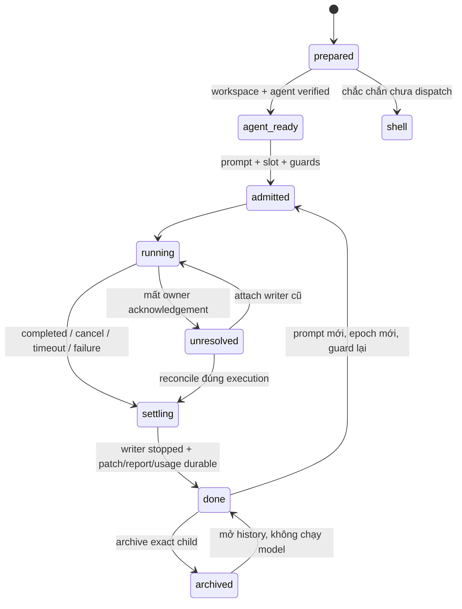

# Hand/subagent thành agent Paseo — spec nháp L2

Ngày nghiên cứu: **09/11/2026**. Trạng thái: **chờ người dùng duyệt; chưa triển khai**. [Plan triển khai](2026-11-09-hand-paseo-agent-plan.md).

## Tóm tắt để duyệt

Mục tiêu là mỗi lượt giao việc có một agent Paseo thật, có quan hệ cha/con, lịch sử và điều khiển riêng, đồng thời giữ worktree, patch, slot, quota, timeout, report và usage của hand-ext. Khuyến nghị **ACP gateway của hybrid-hands bọc runner hiện có**, để Paseo quản lý agent còn hand-ext quản lý việc thực thi. Đây là adapter cần viết mới, không phải capability đã có của plugin. Không gọi lồng `hand-ext run` từ hand; gateway là controller tin cậy, executor vẫn không được delegate.

Các quyết định khuyến nghị:

- Dùng public client Paseo tạo workspace local tại worktree hand-ext đã chuẩn bị, rồi tạo agent với `workspaceId` riêng và `callerAgentId` của cha. Không đặt hand vào workspace cha vì public resolver ép cwd về cwd workspace [E1–E3, probe P1].
- MVP dùng các provider ACP đề xuất `hh-hand-codex`, `hh-hand-dsh`, `hh-hand-claude-v1/v2`, chung một gateway; giữ CLI/parser/backend hiện có. Provider trực tiếp `codex-hand`, `claude`, DSH ACP là phương án sau, cần chứng minh tương đương bảo đảm [E7–E12].
- Subagent native đã spawn của Sol/Claude **không tự biến thành agent Paseo**. Muốn điều khiển như phiên phải định tuyến **lượt mới** sang gateway; đây là thay đổi Ngoại lệ A cần duyệt. Không di chuyển hội thoại hay chạy lại child chưa rõ trạng thái [E13].
- Paseo hiện có **Subagents track ở phiên cha và tab ở workspace của child**. Chưa chứng minh có dòng lồng dưới cha trong sidebar native. Nếu yêu cầu đúng sidebar lồng là bắt buộc, cần gói upstream Paseo riêng; plugin hiện tại không có hook đổi hierarchy native [E5–E6].
- Giữ agent/worktree khi xong để review và mở lại; archive theo thao tác rõ ràng sau review. Không tự archive parent. Mở lại lịch sử không chạy model; gửi tiếp phải qua admission mới. Gateway MVP giữ lịch sử Paseo nhưng chưa hứa resume nguyên hội thoại backend CLI.

Người dùng cần duyệt: gateway hay provider trực tiếp; chấp nhận track/tab hay yêu cầu sidebar lồng; đổi đường native cho lượt mới; archive/retention; ý nghĩa gửi tiếp sau mở lại. Chi tiết và khuyến nghị ở mục 10. Nghiên cứu không sửa code/config, không tạo hay điều khiển agent/workspace thật, không chạy test plugin.

## 1. Phạm vi và mức chắc chắn

### 1.1 Phạm vi

Áp dụng cho lượt hand-ext của bốn backend và lượt việc trước đây Sol định giao native. Không đổi tài khoản/model/effort, không tạo API key, không bật parallel-subagents. Với repo này, cập nhật người dùng trong phiên và commit **`6d3e9c7d5595426497bcfe9d39dfd041102c0617`** chốt order **codex (`gpt-6.1-sol`, low) → dsh → claude-v1 → claude-v2**. Defaults plugin tại checkout nghiên cứu vẫn dsh trước [E18]; không lấy config worktree cũ để đảo quyết định mới. Với repo khác luôn lấy order hiệu lực của repo đó. Review retry cùng backend một lần rồi backend kế tiếp theo order hiệu lực; không hardcode order trong gateway.

Đây là thiết kế L2 do Sol tự nghiên cứu theo ngoại lệ rõ trong brief. Không giao hand L0/L1, không spawn native, không có usage hand để báo; token/USD/quota của công việc nghiên cứu: `?`.

### 1.2 Quy ước bằng chứng

`Đã đọc source` mô tả implementation cài đặt; `đã probe` chỉ nói hàm/fixture đã chạy; `đề xuất` là contract mới chưa tồn tại. Không suy end-to-end từ unit probe. Mọi bằng chứng được đọc ngày **09/11/2026**.

- `P` = `/Users/anhtp/.nvm/versions/node/v24.19.0/lib/node_modules/@getpaseo/cli`.
- `S` = `P/node_modules/@getpaseo/server/dist/server`.
- `C` = `P/node_modules/@getpaseo/client/dist`.
- `R` = `P/node_modules/@getpaseo/protocol/dist`.
- `D` = `/Users/anhtp/.nvm/versions/node/v24.19.0/lib/node_modules/@deepseek-ai/dsh`.
- `H` = `hybrid-hands/plugins/hybrid-hands` tính từ root repo.

Package metadata xác nhận CLI/server/client Paseo **0.15.0**, DSH **0.2.1-rc.5**. Repo nghiên cứu ở `a76826aa1e3ef0ae2ed10aa9b42d066c70c9a070`. Tài liệu public có thể đi trước bản cài; khi khác nhau ưu tiên source 0.15.0.

| Mã | File:dòng hoặc URL công khai — nội dung đã đối chiếu |
|---|---|
| E1 | `C/daemon-client.d.ts:194–212`: create nhận provider/cwd/env/workspace/caller, agentId, idempotencyKey, autoArchive. `R/messages.js:1440–1473`: env chỉ là string map; agentId tạo mới là UUID. |
| E2 | `S/server/agent/create-agent/intent.js:2–28`: cha từ caller, label cha do daemon stamp; explicit workspace trước caller. `S/server/session.js:3310–3346`: public create thay config.cwd bằng intent.cwd. |
| E3 | `S/server/agent/create-agent/create.js:136–173`: resolver MCP dùng resolvedCwd. `P/dist/commands/agent/run.js:368–408,447–459,506–526`: CLI chọn/tạo workspace và truyền caller. `P/dist/utils/caller-agent.js:1–15`: xác minh PASEO_AGENT_ID trên daemon đích. |
| E4 | `R/agent-labels.js:2–17`: label `paseo.parent-agent-id`. `S/server/agent/agent-storage.js:36–59,303–307`: persisted record giữ labels/workspace/cwd/launchEnv và đường JSON theo agent ID. `S/server/agent/agent-manager.js:3999–4007`: inject PASEO_AGENT_ID của chính child. |
| E5 | `S/skills/paseo/SKILL.md:75–93`; `S/skills/paseo-handoff/SKILL.md:53–63`: child giữ parent dù khác workspace, tab/track, send và archive. [Orchestration](https://paseo.sh/docs/orchestration), [workflows](https://paseo.sh/docs/orchestration-workflows), truy cập 09/11/2026. |
| E6 | [OVERVIEW](../paseo-hh-tree/OVERVIEW.md), dòng 5–16,28–30; `P/node_modules/@getpaseo/plugin/dist/client/contracts.d.ts:146–156`: chỉ sidebar header/footer contributions, không hook sửa dòng native. Bundle `S/web-ui/_expo/static/js/web/index-c26368bf062ddf91b40b9d95aae94799.js:18571,18592,18823`: lọc child theo parent label rồi render SubagentsTrack trong ComposerTrackBar; `:16663` là helper parent label. Không dùng sự hiện diện label làm bằng chứng sidebar lồng. |
| E7 | `S/server/agent/provider-registry.js:484–569`: provider custom `extends:acp` cần command; provider kế thừa claude/codex có runtime/env riêng. `S/server/agent/providers/generic-acp-agent.js:4–24`: generic ACP client. [Custom providers](https://paseo.sh/docs/custom-providers), truy cập 09/11/2026. |
| E8 | `S/server/agent/providers/claude/agent.js:1228–1233,1852–1853,2872–2918`: per-launch env, thinkingOptionId → effort, env overlay. `S/server/agent/agent-storage.js:51`: lưu launchEnv. `S/server/agent/provider-launch-config.js:127–143` và `S/server/paseo-env.js:14–30`: merge env daemon, không tự scrub danh sách API key của hand-ext. |
| E9 | `S/server/agent/providers/codex-app-server-agent.js:387,5834–5866`: CODEX_HOME và app-server. Registry E7 chứng minh alias kế thừa codex khả thi; cấu hình `codex-hand` đang dùng được brief cung cấp, phiên này không mở config tài khoản để xác minh. |
| E10 | `D/node_modules/@deepseek-ai/dsh-acp/README.md:55–80`: initialize/new/resume/close/cancel/config, không session/load hay replay. `D/node_modules/@deepseek-ai/dsh-acp-app/cordis.patch.yml:15–20`: profile shipped trỏ deepseek-official/deepseek-v4-flash, khác route hand-ext. |
| E11 | `D/node_modules/@deepseek-ai/dsh-acp/lib/index.js:625–635`: usage_update chỉ context used/size. `S/server/agent/providers/acp-agent.js:1138–1174,2301–2325`: hỗ trợ resume khi không load; context update khác response.usage. |
| E12 | `P/node_modules/@getpaseo/plugin/dist/server/lifecycle.d.ts:93–150`: turn.before là notification, không request gate. `S/server/plugins/lifecycle/index.js:56–80`: các request gate hiện có. [Plugin hooks](https://paseo.sh/docs/plugins/hooks), truy cập 09/11/2026. |
| E13 | `C/daemon-client.d.ts:984–1001`: list/timeline provider subagents, cancelAgent nhận agent ID; không API promote child. `S/server/agent/providers/codex-app-server-agent.js:2518–2538,3834–3870`: session sở hữu app-server và turn/interrupt. [Agent lifecycle](https://github.com/getpaseo/paseo/blob/main/docs/agent-lifecycle.md), truy cập 09/11/2026; không coi main upstream là contract của bản cài. |
| E14 | `P/dist/commands/agent/send.js:143–165`, `wait.js:110`, `stop.js:43–62`, `archive.js:44–63`: send/wait/cancel/archive. `C/daemon-client.js:4378–4399`: wait trả status/final/error, không OS exit backend. |
| E15 | `S/server/session/workspace-recovery/workspace-recovery-service.js:28–74`: còn directory → unarchive; thiếu local directory → unavailable; chỉ owned worktree có đường recreate. `C/daemon-client.d.ts:969–971`: inspect/restore/resume. |
| E16 | `H/lib/side_session/paseo_bridge.mjs:26–93,267–313,334–355`: mẫu target/exact ID, workspace riêng, giữ ID khi follow-up read lỗi, archive workspace có kiểm private. Chỉ tham chiếu snapshot, không sửa vì sol-ws-hoi đang làm. |
| E17 | `H/lib/hand_ext/run_cmd.py:70–114,231–301,493–535`: preflight/day guard, attempt/run/meta/report/ledger/finalize và slot/exit 7/8. `H/lib/hand_ext/parallel.py:29–69`: scope lock kernel, nhả khi controller thoát. |
| E18 | `H/lib/hand_ext/constants.py:94–105,163–172`: defaults order, cap và exit mappings. `git show 6d3e9c7 -- .claude/hybrid-hands.json`: override repo mới codex trước. |
| E19 | `H/lib/hand_ext/isolation.py:133–166,305–343,372–380`: baseline có dirty changes, worktree, patch/check/apply. `H/lib/hand_ext/runner.py:36–40,63–75,93–108,148–184`: scrub, cap/time, pid, parser/report/OS exit. |
| E20 | `H/lib/hand_ext/backends/claude.py:75–94,143–152`; `backends/codex.py:123–143`; `backends/dsh.py:3–20,60–93`: account env, CLI options, DSH launch tránh .env, route Go và NDJSON token. |
| E21 | `H/lib/hh_ps/tree.py:300–341`; `native_source.py:138–158,204–241`; `run_registry.py:68–104`: identity/parent/token nguồn hiện tại, native aliases và attach riêng. |

Các source trong repo có thể mở từ [hand-ext](../plugins/hybrid-hands/lib/hand_ext), [hh-ps](../plugins/hybrid-hands/lib/hh_ps), [bridge mẫu](../plugins/hybrid-hands/lib/side_session/paseo_bridge.mjs). Bàn giao nghiên cứu cwd trước đó: `/Users/anhtp/app/claude-plugins/docs/work-in-progress/handoffs/sol-ws-chung.md`; chỉ dùng làm ngữ cảnh, các kết luận chính đã đọc lại source.

## 2. Paseo orchestration thực sự làm gì

### 2.1 Create, parent và placement

Agent trong Paseo có thể gọi MCP `create_agent`, hoặc shell CLI `paseo run --no-wait`. CLI tự resolve caller từ `PASEO_AGENT_ID` và xác minh trên daemon đích. Public client truyền `callerAgentId` tường minh; không truyền input `parentAgentId` tự chế. Daemon lưu parent bằng label trong record agent, tách biệt với workspace membership [E1–E5].

Nếu bỏ workspace, caller kéo theo workspace **và cwd cha**; explicit workspace kéo theo cwd workspace đó. Bởi vậy `cwd=<hand-worktree>, workspaceId=<parent-workspace>` không giữ được isolation qua public path. MCP có khác biệt resolver, nhưng không chọn internal MCP helper làm cách lách; public tool cũng không hứa input cwd tùy ý. **Khuyến nghị workspace local riêng trỏ đúng `ctx.run_cwd`** của hand-ext, cùng project đã xác minh với cha. Quan hệ parent vẫn giữ [E2–E3]. Nếu repo con của monorepo thì workspace directory là cwd thực thi trong worktree, không tự đổi về worktree root.

### 2.2 Điều khiển và kết thúc

`send` gửi lượt tiếp; `wait` chờ kết thúc lượt; `stop` gọi cancel lượt đang chạy, idle là no-op. Archive là soft archive, CLI thường yêu cầu stop trước hoặc force. Client `waitForFinish` không cung cấp OS exit của executor. Agent idle sau lượt không có nghĩa patch đã apply/report đã durable, cũng không tự đồng nghĩa đã archive [E14]. Gateway chỉ trả ACP prompt thành công **sau** finalization; caller vẫn đọc outcome riêng.

Skill Paseo đã cài hướng dẫn brief tự chứa, chọn profile theo notes, isolation bằng workspace, worker giữ trong track cha. Đó là mẫu tham khảo; policy model/account/quota của hand-ext vẫn có ưu tiên, không tự lấy profile thay kết quả pick [E5, E17]. MCP injection không phải điều kiện bắt buộc của hướng client/CLI; không bật nó trong task này.

### 2.3 Giới hạn sidebar

Đã có bằng chứng track cha và tab workspace; chưa có bằng chứng cho cây agent lồng trong sidebar native. Agent khác workspace vẫn thuộc track cha. `hh-tree` chỉ thêm panel/screen/header button, không thay native list [E5–E6].

**Khuyến nghị MVP nghiệm thu bằng agent thật + parent inspect + track/tab + Cây phiên lồng đúng cha.** Nếu người dùng giữ yêu cầu sidebar native lồng đúng dưới dòng cha, đây là gate L2 chưa đạt: thêm thay đổi upstream app Paseo, kiểm UI riêng; không tuyên bố `callerAgentId` tự giải quyết layout, không sửa bundle cài đặt.

## 3. So sánh kiến trúc và ánh xạ backend

### 3.1 Chọn đường vận chuyển

| Phương án | Được | Phải làm lại hoặc giới hạn | Lựa chọn |
|---|---|---|---|
| A. Client tạo thẳng codex-hand/claude/DSH ACP | Conversation backend tự nhiên; native Paseo settings và lifecycle | Runner không còn là chủ tiến trình; cần parser usage/outcome mới, guard mọi UI follow-up/reopen, scrub env daemon, timeout/cap; hook turn.before không chặn được | Chưa chọn cho MVP; chỉ mở sau khi chứng minh parity |
| B. ACP gateway bọc runner hand-ext | Một Paseo agent thật; runner giữ CLI/account/usage/report/patch; gateway chặn mọi session/prompt trước model call | Viết ACP control/persistence/event mapping và controller recovery; lịch sử trong Paseo không đồng nghĩa resume context CLI | **Khuyến nghị** để giữ bảo đảm |
| C. Chỉ tạo agent quan sát, shell chạy độc lập | Có dòng UI | Stop/archive không sở hữu writer; dễ chạy hai lần/đếm trùng | Loại |
| D. Shell hiện tại | Bảo đảm hiện tại, không phụ thuộc daemon | Không thành agent Paseo thật, không có native sidebar/track | Fallback tường minh |

B không chỉ là một script gọi lại `hand-ext run`: cần tách orchestration/worker để không đệ quy và không giữ hai slot. **Exactly one execution owner**: gateway nhận prompt, executor thực thi backend; frontend CLI chỉ tạo/chờ/đọc outcome. Daemon chạy gateway qua generic ACP; gateway chạy CLI backend thật như runner hiện nay. Đây là suy luận khả thi từ E7 và E17–E20, chưa có probe nối hai hệ.

### 3.2 Backend → provider

Provider `hh-hand-*` dưới đây là tên **đề xuất chưa đăng ký**. Đều `extends:acp`, dùng cùng executable gateway với backend/account cố định. Capability phải được cài qua công cụ/thiết lập chính thức trong giai đoạn triển khai đã duyệt; không tự sửa host config ở lượt tài liệu này.

| Backend | Provider trực tiếp Paseo | Gateway MVP | Làm được / fallback |
|---|---|---|---|
| codex, gpt-6.1-sol low | `codex-hand` kế thừa codex, CODEX_HOME `~/.codex-hand`, thinkingOptionId low [E7,E9] | `hh-hand-codex`; giữ codex backend, không đổi home/config | Có đường source; direct alias theo brief, chưa kiểm live. Gateway cần viết; thiếu thì shell |
| claude-v1, Opus 5.5 low | `claude` + per-agent env `CLAUDE_CONFIG_DIR=~/.claude`, hoặc derived provider riêng [E7–E8] | `hh-hand-claude-v1`; guard ≥5%/ngày và thiếu nguồn đều chặn | Có đường account env; direct chưa chứng minh scrub/parity. Gateway cần viết; thiếu thì shell |
| claude-v2, Opus 5.5 low | `claude` + `CLAUDE_CONFIG_DIR=~/.claude-hand`, hoặc derived provider riêng [E7–E8] | `hh-hand-claude-v2`; cùng policy đúng account | Có đường account env; chưa chạy live. Gateway cần viết; thiếu thì shell |
| dsh, deepseek-v4.1-flash off | Custom ACP: command trỏ wrapper `dsh --profile acp`, không phải provider dsh builtin [E7,E10] | `hh-hand-dsh`; giữ headless NDJSON/Go route/sandbox hiện tại | ACP thật có sẵn nhưng route shipped sai mục tiêu, usage chỉ context [E10–E11]. **Giữ shell hiện tại** cho tới gateway đạt parity; không chỉ đổi command sang dsh ACP |

Model IDs/effort gateway là giá trị canonical của hand-ext. Không dùng model opaque của DSH ACP hay tên provider Paseo làm key pricing. V1/v2 không hoán đổi khi guard chặn. Direct env chỉ là overlay lên env daemon; việc xóa key ở frontend không xóa key của daemon. Nếu chọn A sau này phải dùng launch wrapper scrub đúng BLOCKED_ENV, không gửi credential qua env request (launchEnv được lưu) [E8,E20].

### 3.3 Native Sol và Claude Code

Native Codex do `spawn_agent` hiện tại tạo là thread do provider/app-server quản lý, có provider-subagent list/timeline; không phải daemon agent độc lập. API đã đọc không có promote/reparent child thành full Paseo agent, cũng không có cancelAgent bằng native child ID [E13]. Không thể chuyển child đang chạy sang gateway mà giữ nguyên cam kết không trùng writer. Giữ native cũ ở hh-ps, không fake run/meta/report/ledger cho chúng.

**Khuyến nghị:** sau duyệt Ngoại lệ B, task mới trước đây định spawn native được giao qua dispatcher Paseo với `origin=native-intent`; pick vẫn đúng backend/model/effort/account và brief tự chứa. Lượt này là **managed hand mới**, có run/meta/report/ledger thật một lần, không còn là native Codex theo Ngoại lệ A. Nếu không duyệt thay semantics, giữ native như hiện tại và ghi rõ không đạt mục tiêu stop/archive riêng như phiên. Không intercept tool runtime, không bật parallel-subagents.

Claude Code `hybrid-hands:hand` cũng là provider-native, không tự có agent Paseo ID. Đưa **task mới** sang gateway Claude đúng account là thay đường thực thi, không lift nguyên subagent/hội thoại. Conversion child đang có và thay implementation Agent tool ngoài phạm vi MVP [E5,E13]. Đây là giới hạn API khảo sát, không khẳng định mọi phiên bản tương lai đều không làm được.

## 4. Contract thực thi và bảo đảm

### 4.1 Quyền sở hữu và identity

Đề xuất record điều khiển durable riêng, khác registry best-effort hiện có [E17,E21]. Trường mới thêm cuối với default ở dataclass công khai khi cần. Một logical invocation có `invocation_id`; mỗi backend attempt có `run_id`, `attempt_id`, một Paseo agent ID. Retry/fallback khác backend tạo attempt/agent mới sau khi attempt trước chắc chắn quiescent; chỉ một attempt sở hữu writer tại một thời điểm. Cùng agent được mở lại để xem lịch sử; gửi tiếp tạo `execution_epoch` mới với backend cố định.

Record gồm `schema_version`, `scope_id` của Sol, `parent_session` canonical, `parent_paseo_agent_id`, `target_key`, `workspace_id`, `agent_id`, `origin`, `backend/account_alias`, `model/effort`, `transport`, source cwd, isolated cwd, baseline/patch paths, trạng thái/epoch, `prompt_receipt`, lease/process identity, timestamps, status, nullable backend exit code và nguồn token. Không ghi auth/env values/prompt vào labels. Nhãn chỉ chứa ID/loại công việc được phép công khai. Scope giới hạn pool, không làm parent ID.

Frontend cấp UUID/idempotency key và ghi intent **trước request create**. Gateway phải đối chiếu record authoritative, target/cwd/parent/backend/account/epoch, không tin labels/path do prompt cung cấp. Resume ACP dùng session ID này để mở record cũ, không tự chạy prompt. Persistence phải hoạt động qua runtime idle cleanup/restart; không phụ thuộc gateway luôn còn sống [E1,E4,E11].

Phạm vi file được giao là ràng buộc điều phối: việc cùng file/phụ thuộc phải tuần tự, kể cả khác worktree hay khác agent ID. Admission lưu phạm vi ghi và chặn xung đột đã khai báo; patch apply giữ `git apply --check`, không force ghi đè thay đổi phát sinh ở source repo. Giữ các thay đổi chưa commit của người khác.

### 4.2 Admission và pool

Mỗi `session/prompt`, kể cả từ app/CLI/MCP, phải qua gateway admission: khóa epoch + kiểm còn writer → đọc policy hiệu lực → pick/preflight/guard lại → giữ slot scope → chạy đúng backend. Backend/account cố định của agent không khớp pick thì từ chối, trả lý do an toàn để dispatcher xử lý; không âm thầm đổi account trong phiên. Metadata/model/effort UI không được đổi policy; catalog chỉ quảng bá cấu hình hợp lệ, option lạ bị từ chối trước executor.

Pool chung `ext_hand.max_parallel` 1..4 gồm managed Paseo, hand shell và legacy native đang chạy. `parallel.py` hiện chỉ khóa tiến trình hand-ext; chưa có admission native chung bằng kernel [E17]. Cần adapter đăng ký native + shared supervisor/lease reconciliation. Khi vẫn cho phép native tool ngoài dispatcher, không thể cưỡng chế cap tuyệt đối từ gateway: discovery chỉ phát hiện sau spawn. **Gate release:** mọi task mới đi dispatcher; legacy đang chạy được đối chiếu trước giữ slot, unknown chiếm chỗ bảo thủ tới khi reconcile. Không gọi đây là bảo đảm đã có.

Không nhả slot vì frontend thoát hay mất kết nối trong khi daemon còn writer. Đề xuất supervisor thực thi giữ khóa xuyên suốt executor và finalization, process identity chống PID reuse; dispatcher kiểm durable unresolved record trước admission. Gateway EOF/crash phải cancel/reap process group do nó sở hữu; nếu chưa chứng minh dừng được thì giữ reservation unresolved. Không dùng lock-file unlink hay TTL hết hạn làm bằng chứng writer đã chết.

### 4.3 Ma trận bảo đảm

| Bảo đảm hiện tại | Direct A | Gateway B phải bảo toàn |
|---|---|---|
| Worktree sạch, mang dirty baseline an toàn, patch/apply | Cần nối lại controller | Dùng isolation.prepare/finalize; chỉ một owner apply, xung đột giữ patch; không copy secret/ignored [E19] |
| Slot/exit 8 | wait/idle Paseo không thay admission | Shared supervisor; full trước dispatch → exit 8, không đổi backend; unknown không giải phóng |
| Pick/order/quota/guard v1/exit 7 | Paseo create không tự chạy hand-ext guard | Giữ preflight đúng account; hết order → 7 + doctor metadata an toàn; không dùng lỗi daemon làm lý do skip backend [E17–E18] |
| Timeout/token cap/max turns/sandbox/browser | Phải map khả năng provider và kiểm tương đương | Giữ RunSpec + runner backend options; timeout ngoài frontend, cancel quiescent; token cap theo semantics polling hiện tại, không hứa trần tuyệt đối [E19–E20] |
| DSH capacity retry/patch-preserve | ACP stopReason không đủ thay classifier | Giữ capacity.py/run_cmd policy, order repo mới; không đổi thành quota hay retry vô hạn |
| OS exit/status/report | wait không có backend exit [E14] | Lưu OS exit executor thật, status nguyên nhân, report durable; exit gateway khác exit backend. Chưa quan sát thì null |
| Token ledger/USD~ | Event stream khác, DSH context không đủ | Giữ parser/poll nguồn backend và canonical pricing; ledger exactly once theo run/epoch, không ghi thêm ledger từ ACP |
| Stop/archive/reopen | Paseo có lifecycle nhưng không điều phối patch/slot của hand-ext | Cancel chặn admission mới, dừng writer, drain/finalize trước settle; reopen history không model; prompt mới guard lại |

**Mất hoặc chưa có:** A làm mất các bảo đảm phụ thuộc runner nếu chỉ thay lệnh create. B giữ được về thiết kế nhưng cần làm mới control/recovery/pool/ACP mapping; chưa được chứng minh runtime. B MVP không giữ sẵn native backend context qua send tiếp, không nâng native đang chạy, không bảo đảm sidebar lồng, và phải giữ worktree lâu hơn để reopen. Không che những giới hạn này bằng agent quan sát giả.

## 5. Vòng đời sidebar, archive, reopen và workspace

Tên agent đề xuất `HAND <backend> · <nhãn việc ngắn> · <run-id ngắn>`; origin native-intent có thể dùng `TASK` để tránh gọi nhầm là native runtime. Không đưa prompt, path khách hàng hay giờ bắt đầu lên tên. Agent Paseo mang parent canonical; workspaces thuộc cùng project đã xác minh, không đoán bằng cwd đơn thuần. Không dùng background=true vì có thể làm child biến khỏi UI; phải kiểm workspace/parent background inheritance trước launch [E2,E5].

Khuyến nghị khi done: giữ agent và workspace active tới review, sau đó archive exact child theo yêu cầu rõ ràng; không tự force archive running. Archive agent không phải xóa worktree. Giữ worktree để lịch sử/reopen còn cwd hợp lệ. Archive workspace riêng chỉ sau xác minh toàn bộ membership kể cả archived siblings và không có writer/terminal đang dùng; tuyệt đối không archive workspace/project/agent cha [E14–E16].

Reopen có hai việc tách biệt: recovery workspace còn directory qua inspect → restore/unarchive, và mở lại agent/history cùng ID. Gateway history/resume không có tác dụng phụ chạy model; lần gửi prompt mới là epoch mới. Không giả định `resumeAgent(handle)` tương đương unarchive đúng ID; phải kiểm public API/UI thực tế trong gói spike. Khớp contract sol-ws-hoi bằng exact target/workspace/agent IDs và inspect recovery, **không sửa hoặc copy luồng chưa merge của phiên đó** [E15–E16].

Workspace local trỏ worktree do hand-ext sở hữu: nếu đã cleanup directory thì Paseo recovery báo unavailable, không tự tạo lại như owned Paseo worktree [E15]. Vì vậy MVP **không tự dọn** directory sau done/archive. Gói cleanup tùy chọn sau: cần snapshot/baseline/patch durable và kiểm không reference/dirty/unapplied; dọn thì đánh dấu history-only, cấm tiếp tục ghi trên cwd mất. Không xóa/di chuyển output/llm. Không đặt retention ngày tùy tiện trước khi người dùng chốt.

Gửi tiếp từ app MVP là task tự chứa mới trong **cùng lịch sử Paseo**, không tự resume CLI context. Epoch mới snapshot baseline mới và patch delta mới; patch cũ không apply lại. Backend retry vẫn tuân một lần cùng backend theo policy review; đây khác yêu cầu follow-up mới của người dùng. Nếu cần resume nguyên hội thoại backend như phiên native, chọn gói direct A hoặc adapter resume riêng sau, không claim sẵn có.

## 6. Fallback không tạo writer trùng

| Tình huống | Hành vi đề xuất |
|---|---|
| Trước mutation, daemon không chạy/thiếu provider/capability hoặc không resolve được parent đúng target | `auto` về shell cùng backend/policy và ghi transport=shell, lý do an toàn; không khẳng định có dòng Paseo. `paseo-required` trả lỗi transport riêng, không mượn exit 7/8 |
| Workspace đã tạo nhưng agent chắc chắn chưa tạo/chưa gửi prompt | Reconcile resource ID; shell được chạy nếu chứng minh chưa có writer, giữ record cleanup workspace; không cleanup parent |
| Timeout create, thiếu ID hoặc reply mất | Dùng UUID/key/label invocation + target đã lưu để fetch/reconcile cả archived; không tạo lại hay shell trong trạng thái ambiguous |
| Agent đã có, send mất ACK / daemon restart / UI gửi tiếp | Reconcile receipt + epoch + supervisor. Attach execution cũ; không gửi lại prompt hay chạy backend khác vì im lặng |
| Cancel chưa được xác nhận quiescent | Giữ unresolved, không finalize/apply/nhả slot/fallback; timeout bounded cho thao tác kiểm, báo cần reconcile |
| Backend thật quota/login/capacity | Sau settlement áp policy hand-ext hiện có theo order repo, giữ các attempt riêng; không gộp lỗi transport thành quota |

Đề xuất settings vận chuyển `shell | auto | paseo-required` là contract mới cần code/schema/tài liệu sau duyệt. Default trong code lúc rollout đầu: shell; bật auto cho repo pilot đã duyệt sau capability gate. Không sửa config hiện tại trong task này. Fallback shell từ native-intent là lượt managed mới; nếu policy yêu cầu native A thì trả giới hạn cho caller, không tự đổi semantics.

## 7. Token, hh-ps, Cây phiên và statusline

Nguồn trạng thái mới là record supervisor/runner và metadata Paseo, nối bằng bảng identity explicit. Một execution được thấy dưới dạng hand run + Paseo agent + rollout thì **chỉ có một dòng canonical**, không thêm Session thứ hai chỉ vì có agent ID. Dùng khóa `(target_key, agent_id, execution_epoch)` ánh xạ run/attempt/thread/provider session; native legacy vẫn dùng thread metadata cố định như E21. Không đoán cha theo scope/cwd, không gán native parent_thread_id giả cho Codex exec do gateway chạy.

Hand-ext ledger/registry là nguồn usage của managed execution; Paseo timeline chỉ là projection. Nếu đồng thời có rollout, chọn một nguồn per execution; GPT machine USD tuần vẫn tổng token delta trong reset hiện tại từ sessions + archived_sessions, dedup thread/event, **không cộng ledger vào rollout**. Claude/Go dùng nguồn hiện có đúng account. Không cộng child vào parent usage nếu nguồn parent đã bao gồm child; thiếu provenance giữ `?`. Giá duy nhất từ [model-prices.json](../plugins/hybrid-hands/config/model-prices.json), không lấy cost Paseo như hóa đơn.

ACP DSH `used/size` không là token billable [E11,P3]. Gateway xuất usage từ runner parser; thiếu input/cache/output thật thì unknown, không biến 0 mặc định trong record cũ thành 0 đã đo. OS exit không có thì null, không lấy idle/archivedAt/mtime làm thành công. Outcome lỗi/exit khác 0 ưu tiên; running chỉ khi owner chứng minh còn chạy, unresolved là unknown.

hh-ps text/JSON giữ orphan như contract; hai giao diện cây không hiện nhóm orphan. Managed child là hand/subagent trong pool 4, **không ăn thêm slot phiên phụ trong giới hạn 6**. Giữ selection gần nhất, counts hidden/ties/colors, giờ kết thúc local và elapsed cố định, không hiện giờ bắt đầu. Panel không cần tự gọi daemon lấy timeline hay sửa native sidebar. `hh-tree-pane` giữ bố cục, chỉ nhận identity/status tương thích nếu cần.

Statusline tiếp tục helper usage hiện có, không đọc conversation mới, không thêm bảng giá hay suy quota GPT từ token/USD. Nếu đủ shared helper thì chỉ kiểm regression fixture, **không sửa statusline**; nếu thật sự cần sửa plugin riêng thì trình scope/version/release riêng trước. Khối machine_usage độc lập cây, account 5h/tuần không thay nhãn phần riêng session; quota thiếu vẫn `?`.

## 8. Contract ACP gateway đề xuất

Không dùng thư viện ACP client có mặt làm bằng chứng server đã triển khai. Gateway phải đáp ứng tối thiểu: initialize, session/new, session/prompt, session/cancel, session/resume hoặc session/load theo capability thật, và session/close. Danh sách/model/effort quảng bá đúng backend đã pin; không hứa modes/forks hoặc arbitrary MCP nếu chưa có mapping. Paseo ACP hỗ trợ resume-only, nên không bắt buộc replay history backend [E7,E10–E11].

ACP stdout chỉ protocol; stderr chỉ safe code, không forward raw credential/error. Provider response `usage` chỉ chứa token đo đúng, context occupancy tách riêng. Completed trả stopReason phù hợp; failure giữ failure state/outcome, không map mọi lỗi thành end_turn. `max_tokens`/`max_turn_requests` cần outcome cap riêng vì generic adapter có thể coi chúng là turn_completed [E11]. Wrapper frontend dùng outcome record để quyết định exit, không dùng riêng trạng thái màu UI.

Gateway không nhận quyền repo/cwd/account từ lời nhắc. Nó chỉ nhận reference tới record authoritative ngoài worktree writer, backend fixed từ provider launch + đã đối chiếu. Dữ liệu điều khiển ghi atomic và khóa; hỏng/thiếu record → fail closed trước executor. Executor không tự tạo agent; không hand-ext recursion, không side-session, không spawn subagent/review hand khác.

## 9. Kiểm chứng đã làm và chưa làm

Đã đọc source, skill/reference đã cài và các URL public trong bảng E; không chạy những workflow tạo agent trong skill tham khảo. Không đọc config credential, .env, auth, transcript hay log thật; không kết nối model API.

Probe bằng `node --input-type=module` stdin với fixture công khai, exit **0**, ba nhóm PASS:

1. **P1:** extract method resolver nguyên bản cài + import pure intent; fake caller/workspace registry. Workspace cha và không chỉ định workspace đều ép cwd về cha; workspace child `/public/isolated` giữ cwd đó và parent `parent-fixture`. Ba fixture assert, không nối daemon/create resource.
2. **P2:** gọi helper env bằng base map tự tạo `FAKE_API_KEY=fixture-only`; overlay account dir không xóa synthetic key. Đối chiếu type đã cài: turn.before thuộc event, không thuộc PluginHookRequests. Không đọc/hiện env thật.
3. **P3:** extract hàm usageUpdate DSH ACP, feed fake input/output/context; chỉ nhận `{sessionUpdate:"usage_update",used:123,size:1000}`, không có token billable.

Chưa probe: gateway chưa tồn tại; ACP handshake giữa Paseo và DSH/gateway; alias/account launch live; stop/crash/reopen runtime; sidebar nhìn bằng app; idempotency qua restart; không trùng usage end-to-end. Không chạy test plugin, không validate/install/reload/bump/release. Probe dùng stdin, không tạo script tạm hay tiến trình nền.

## 10. Câu hỏi mở cần người dùng chốt

1. **Chọn B gateway hay A direct?** Khuyến nghị B để giữ guard/usage/report và chặn mọi prompt UI. A chỉ sau khi có admission tương đương; không bỏ cam kết mà không nêu rõ.
2. **Track cha + tab child + Cây phiên đủ cho MVP không?** Khuyến nghị có. Nếu bắt buộc sidebar native lồng, thêm gói upstream Paseo và nghiệm thu UI riêng trước coi mục tiêu hoàn thành.
3. **Thay Ngoại lệ A cho lượt mới?** Khuyến nghị opt-in Ngoại lệ B: native-intent → managed gateway với record/ledger thật. Legacy native giữ nguyên, không migrate đang chạy. Claude native conversion ngoài phạm vi; task mới có thể route đúng account.
4. **Archive khi nào?** Khuyến nghị giữ active sau done để review, archive child theo thao tác rõ ràng; không auto archive ngay hoặc archive workspace cha. Có muốn auto archive thành công sau review không?
5. **Reopen có cần backend context đầy đủ ngay MVP?** Khuyến nghị lịch sử Paseo + epoch/task mới tự chứa; full backend resume là gói sau. Nếu cần như phiên native ngay thì tăng scope A/adapter resume, không chỉ đổi tên UI.
6. **Giữ worktree bao lâu?** Khuyến nghị không cleanup tự động ở MVP để giữ reopen. Retention/cleanup history-only là gói riêng sau duyệt; chi phí disk cần đo, không tự chọn số ngày.
7. **Rollout và fallback:** khuyến nghị shell mặc định, auto cho repo pilot đã duyệt, required để người dùng biết không đạt Paseo. Chỉ cài provider qua công cụ/setup chính thức sau duyệt, không tạo key/tài khoản mới.

Các câu hỏi này không chặn việc hoàn tất tài liệu; chúng chặn triển khai các lựa chọn tương ứng. [Plan](2026-11-09-hand-paseo-agent-plan.md) đặt gate trước mọi mutation live.
